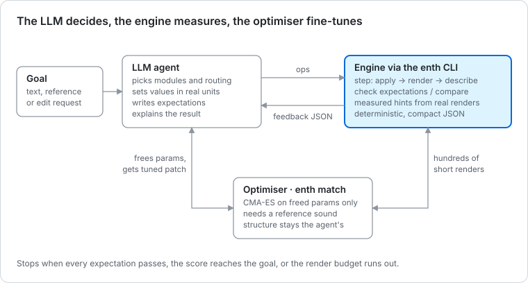

# The `enth` CLI — built for agents, usable by humans

**Goal: an LLM agent can build a patch on its own** — choose modules, set parameters, render, get feedback it can act on, and iterate until the sound meets a goal. The same CLI serves humans, shell scripts, ML pipelines and other programs. An MCP wrapper can be added later as a thin shim over it.

## The division of labour

LLMs are good at intent and structure ("a pluck needs a fast attack and a filter envelope") and bad at hearing fine detail or tuning numbers by ear. Current audio-input models perform near chance on basic attributes like pitch and brightness ([SonicBench, 2026](https://arxiv.org/html/2601.11039)). So the work is split three ways:

| Who | Does what |
| --- | --- |
| **The LLM** | Picks modules and routing, sets rough values in real units, writes expectations for text goals, explains choices |
| **The engine** | Renders deterministically and measures: descriptors, pass/fail checks, distances, and *measured* parameter sensitivities |
| **The optimiser** | Fine-tunes the parameters the LLM chose to free, when there is a reference sound |



## Design rules

1. **JSON by default when stdout is not a TTY**; tables for humans. One JSON object per call (JSONL for streams). Every object carries `"schema": "enth.<command>/<version>"`.
2. **Real units everywhere.** `filter1.cutoff=800Hz`, `env1.attack=40ms`, `osc2.fine=12ct`, `comp1.mix=30%`. The CLI parses unit strings into the parameter's plain value using the parameter schema ([design.md §1](design.md#1-one-parameter-schema-eight-consumers)); normalised 0–1 values never appear in the CLI.
3. **Stateless files.** Every command reads a patch file and, if it changes it, writes it back, or a new one with `--out`. History is files: agents can branch, diff and roll back. An optional daemon may come later purely for speed.
4. **Deterministic.** Fixed default seed, sample rate (48 kHz) and render length; sorted keys; numbers rounded to 4 significant digits (2026-10-19, as built: an integral number prints exactly, so `65535` and `48000` survive; the `ops` and `inverse` arrays stay exact so they can be replayed).
5. **Self-describing.** `enth schema`, `enth modules`, `enth params <module>` and `enth guide` (a one-page workflow guide for agents) mean no outside docs are needed.
6. **Errors teach.** Exit codes are stable; error JSON says what was wrong and how to fix it:
   `{"error":"unknown_param","path":"filter1.cutof","did_you_mean":["filter1.cutoff"],"hint":"enth params svf"}`
   `did_you_mean` also draws on the CLI's alias table: names an agent is likely to guess, mapped to the catalogue's keys (`detune` → `fine`, `res` → `resonance`). So `osc1.detune` gets `"did_you_mean":["osc1.fine"]` where edit distance alone would find nothing. The table lives in the CLI and only feeds suggestions; the catalogue keys, which patches store, have no aliases.
7. **Small outputs.** Summaries by default; `--full` or `--fields` for more. Never dump a whole patch unless asked.
8. **Every edit is an op** — the same ops the UI emits and undo stores ([design.md §2](design.md#2-patch-model-ops-and-versioning)).
9. **Types are the schema.** Each output is a Rust struct (`Serialize + Deserialize + JsonSchema`, `deny_unknown_fields`) and `enth schema <name>` prints its JSON Schema (draft 2020-12, from `schemars`). Tests snapshot the output (insta), deserialize it back into the struct, and snapshot the schema itself, so code and schema cannot drift. There is no `jsonschema` crate: its default features pull in a C build. Any change to an output's shape, or to a field's meaning (like `decay_ms` between the spike and P1), bumps its version and updates the snapshots (AGENTS.md).

| Exit code | Meaning | Error codes (`enth.error/1`, as built in P1a) |
| --- | --- | --- |
| 0 | OK (for `check`: all expectations passed) | |
| 1 | Ran fine, but `check` had failures | |
| 2 | Usage error (bad flags) | `usage` (clap, with the usage line in `hint`), `bad_expect`, `bad_perf`, `nothing_to_apply`; R1: `bad_level`, `bad_budget`, `bad_stop_at`, `bad_seconds`, `bad_free`, `bad_workers`, `bad_amount`, `perf_required`, `perf_fixed`, `phrase_fixed`, `unknown_phrase`; R3 `enth create`: `bad_candidates`, `bad_score_seconds`, `bad_out`, `dur_fixed` (and the R1 `bad_budget`, `bad_stop_at`, `bad_seconds`, `bad_workers`, `bad_perf`) |
| 3 | Validation error (bad patch, unknown param, value out of range) | every `enth-patch` code (`unknown_param`, `unknown_module`, `out_of_range` with `try`, `min`, `max`, `bad_value`, `wrong_unit`, `bad_json`, `unknown_op`, …), `unknown_feature`, `unknown_kind`, `unknown_template`, `unknown_topic`, `unknown_schema`, `not_a_patch`; R1: every `enth-challenge` code a code or file can raise (`bad_check`, `bad_symbol`, `code_too_new`, `target_mismatch`, `silent_target` for a code whose target nobody can hear, …), `unknown_category`, `nothing_to_search`; R3 `enth create`: `unknown_format`, `bad_file`, `sample_rate`, `no_audio` (the file), `intake` (a silent file or one the analysis refuses), `not_a_bank` and the bank's other codes |
| 4 | Render or analysis failure | `render_failed`, `analysis_failed`, `unsupported_wav`, `write_failed`; R1: `start_failed`, `pool_failed`, `silent_target` and the solver's own codes; R3 `enth create`: `time_cap`, `no_candidate` |
| 5 | File not found | `file_not_found` |

Every error object has `error`, `message`, `exit`, `hint` and `did_you_mean` (possibly empty), and where it applies `path` (an address such as `filter1.cutof`, an op such as `ops[2]`, or a path into a file such as `generators[1].params.cutoff`), `file`, `known` (the valid names, when the list is short) and `errors` (every problem, when a file has several). On a terminal the error is plain text on stderr instead.

## Commands

| Command | Purpose |
| --- | --- |
| `enth guide [--topic expect\|ops\|descriptors]` | Print the agent workflow guide (one markdown page, at most about 6 KB) |
| `enth schema [patch\|ops\|perf\|describe\|check\|…]` | JSON Schemas for files and outputs (the list without a name) |
| `enth modules` / `enth params <kind\|voice\|master\|id> [--patch p]` | Catalogue: module kinds; params with units, ranges (shown prominently: agents in the Phase 0 probe were surprised by range limits), defaults, accepted spellings, one-line descriptions, perceptual effect, and `reads_as` where a knob and its descriptor differ (2026-10-20: `envelope.release_ms` reads about half the `release` knob). A module id (`filter1`) resolves to its kind |
| `enth new --template <name> --out p.patch.json` / `enth new --list` | Start from a template (`init`, `pluck_1osc`, `pad_2osc`, `bass_sub`); the file is written dense and stamped with the engine version |
| `enth random --seed 7 --difficulty 0.4 [--amounts filter=0.5,effects=0] [--musical 0.8] --out t.patch.json` | Generate a Recreate target with the same randomizer as the game ([design.md §9](design.md#9-randomizer-and-difficulty)) |
| `enth apply p.patch.json --ops '<json>' \| --set k=v[,…] [--out p2.patch.json] [--dry-run]` | Apply ops (`--set` is sugar for `set` ops; both may be given, ops first); in place without `--out`. Prints the applied changes in real units (a route change adds `means`: what its depth does to the destination), the resolved ops and the inverse ops (exact). `--ops` takes inline JSON, `@file.json` or `-` (stdin) |
| `enth get p.patch.json [addr…] [--plain]` / `enth diff a.patch.json b.patch.json [--describe]` | Read values (unit strings; numbers with `--plain`; `filter1`, `voice`, `master`, `routes`, `modules`, `meta` as well as addresses; no address gives a summary of what differs from the defaults); compare patches (the changes, and ops that turn `a` into `b`, verified by applying them) |
| `enth render p.patch.json [--note C3 --vel 100 --hold 1.5 --dur 3 \| --perf perf.json] [--out p.wav] [--bits f32\|16\|24] [--seed n]` | Deterministic render. Writes a stereo 32-bit float WAV with an `enth` chunk holding the performance (`--bits 16\|24` for integer PCM, same chunk); reports `peak_dbfs`, `true_peak_dbtp`, `clipped_pct` and `clipping` over both channels |
| `enth describe <wav\|patch> [--perf perf.json]` | Perceptual descriptors (renders first if given a patch). A WAV needs its performance. Precedence: `--perf`, then the `enth` chunk that `render` wrote, then an inferred note-off (`perf.source` says which: `flag`, `default`, `wav`, `inferred`, `none`); otherwise decay, sustain and release come back null, and `missing` says why for every null descriptor |
| `enth check <wav\|patch> --expect '<list>' [--perf perf.json] [--no-fix] [--fix-budget 16]` | Pass/fail per expectation with its margin and noise, and one measured multi-parameter `fix` for all the failures |
| `enth compare <patch> --target <patch\|wav>` / `--code <code>` / `--challenge FILE` | Distance to a reference (patch or WAV) with the perceptual differences, or the Recreate score against a challenge (`enth.compare/2`) |
| `enth suggest p.patch.json --code <code> [--level 1..4]` | The game's hint button: which aspect is off, which module, which parameter and which way, a range; never the target's values at levels 1 to 3 (`enth.suggest/1`) |
| `enth match --target <wav\|patch\|code> [--start p] [--free <addrs>\|--level N] [--budget N] [--workers N] [--stop-at D] --out p2.patch.json` | Optimiser fine-tunes only the freed params; the same result for any worker count (`enth.match/1`) |
| `enth step p.patch.json --ops '<json>' \| --set k=v[,…] [--expect …\|--target …] --out p2.patch.json` | apply + render + describe + check/compare in one call (fewest round trips). It echoes only the features named in `--expect` plus a headline, unless `--full` |
| `enth explain <addr\|module\|kind> [--patch p]` | Plain text and JSON from the catalogue for a parameter, a module or a kind; with `--patch`, what a just-noticeable step of the parameter does in that patch (`enth.explain/1`) |
| `enth challenge new\|show\|decode` | Make, regenerate and read Recreate challenges and their codes (`enth.challenge-new/2`, `enth.challenge-show/2`, `enth.challenge-decode/1`) |
| `enth lesson list\|show\|start\|check\|hint\|closest <pack> …` | A lesson pack's lessons and steps; what a step loads; one do step's check against a patch file; a step's hint; a round's nearest passing patch (`enth.lesson-list/1`, `-show/1`, `-start/1`, `-check/1`, `-hint/1`, `-closest/1`; [below](#lessons-on-the-command-line-enth-lesson)) |
| `enth create --target <wav\|flac\|ogg\|mp3> [--candidates K] [--seconds S] [--budget N] [--stop-at D] [--score-seconds S] [--bank F] [--perf …] [--out P] [--record F]` | Patches that sound like a recording: the intake finds the sound in the file, a portfolio of starts is screened, K branches are refined by the robust distance; K candidates with their provenance and traces, every start as a patch, and what to do next (`enth.create/1`; [below](#creating-patches-from-a-sound-enth-create)) |
| `enth validate` / `enth migrate` | Check and upgrade patch files |
| `enth bench [--patch p] [--voices 8] [--seconds 10]` | Engine speed: ×realtime per core, ns per voice per frame (wall-clock, information only; the regression gate is instruction counts in `xtask`) |

**CLI v0 (P1a) is 13 commands:** `schema`, `modules`, `params`, `new`, `apply`, `get`, `diff`, `render`, `describe`, `check`, `step`, `guide` and `bench`, each with a defined output shape. R1 adds `challenge`, `compare`, `suggest`, `match` and `explain` (below); `random`, `validate` and `migrate` come later (`challenge new` already generates targets with the game's randomizer).

### CLI v0 as built (2026-10-19, P1a lane C)

`crates/enth-cli` is a thin binary over `enth_cli::run(args, stdin) -> Output { code, stdout, stderr }`; snapshot tests run in process.

| Schema id | Printed by |
| --- | --- |
| `enth.schema/1`, `enth.modules/1`, `enth.params/2`, `enth.guide/1` | `schema` (the list), `modules`, `params`, `guide` |
| `enth.new/1`, `enth.templates/1` | `new`, `new --list` |
| `enth.apply/2`, `enth.get/1`, `enth.diff/2` | `apply`, `get`, `diff` |
| `enth.render/1`, `enth.describe/2`, `enth.check/2`, `enth.step/2`, `enth.bench/1` | `render`, `describe`, `check`, `step`, `bench` |
| `enth.suggest/1`, `enth.match/1`, `enth.explain/1` | `suggest`, `match`, `explain` (R1, lane CL) |
| `enth.challenge-new/2`, `enth.challenge-show/2`, `enth.challenge-decode/1`, `enth.compare/2` | `challenge new\|show\|decode`, `compare` (R1: lane SKR's /1 shapes, versioned by lane CL) |
| `enth.error/1` | every error |
| `enth.patch/1`, `enth.ops/1`, `enth.perf/1`, `enth.wavmeta/1` | input documents: a patch file, the ops JSON, a performance, the WAV chunk |

`enth schema <name>` prints the JSON Schema itself (draft 2020-12, `$id` set to the schema id, the `schema` field pinned with `const`).

Version 2 (2026-10-20, P1b lane EV, the G1 eval findings in [p1a-g1.md](p1a-g1.md)): `params` adds `reads_as`; `apply`, `diff` and `step` add `means` to route changes; `describe` adds `tonal` and `modulation.filter_sweep` and reads its envelope with a tremolo fitted out; `check` and `step` call a true/false item `thin` only when the re-renders disagree.

- **Performance.** Patch files (schema 1) carry no performance. Without flags every command plays the default: C3, velocity 100, held 1.5 s, in a 3 s clip (`perf.source: "default"`). `--perf` takes inline JSON (`enth.perf/1`; `schema` may be left out, so an eval goal's `perf` table works as is), a file, `-` (stdin) or the short form `note=A3,vel=100,hold=1.5s,dur=2.5s`; `--note`, `--vel`, `--hold`, `--dur` change one field of a single-note performance (`--hold` alone sets the clip to hold + 1.5 s). The judge passes the goal's performance, so agents must pass it on every `step` too. `perf.source` is `flag`, `default`, `wav`, `inferred` or `none` (there is no `patch` source while patches store no performance).
- **The WAV.** Stereo IEEE float (format 3, an 18-byte `fmt ` chunk and a `fact` chunk), then an `enth` chunk with `enth.wavmeta/1` JSON (`engine`, `sample_rate`, `seed`, `patch_hash`, `perf`), padded with spaces to an even length so no pad byte follows it (hound skips unknown chunks but not their pad byte), then `data`. `describe` and `check` on a WAV analyse the mean of its channels.
- **`check`.** The judged render uses the default seed (or `--seed`); the two nuisance re-renders use seeds derived from it, which move only the start phases of oscillators in `free` phase mode (the default). On a WAV the noise comes from re-analysing the signal delayed by 137 and 311 samples. Per item: `expect` (canonical), `got` (in `unit`), `pass`, `margin`, `margin_unit` (only when it differs from `unit`: `ct` for a pitch judged against a note), `margin_pct` (Hz and ms items), `noise`, `thin`, `note` (pitch and tonal-pitch items: `C3+9ct`), `why` (when `got` is null), and `lower_bound`, `estimated`, `unstable` when true. A true/false item has margin 0 and is `thin` only when a nuisance render disagrees with it (2026-10-20; before, every `clipping = false` was thin). `check` and `step` judge identically.
- **`fix` and `blocked`.** The search is lane H's `enth-solver::hint` ([dsp/hints.md](dsp/hints.md)); the CLI (`crates/enth-cli/src/fix.rs`) calls it only for a patch with failures, not with `--no-fix` and not with `--fix-budget 0`, with the goal's performance and a rayon evaluator that is the solver's own `measure` (so the hint's `before` is `check`'s reading, to the bit, for any number of workers). `fix.ops` are `{"set": "<addr>", "to": "<value with unit>"}` in the units the parameter shows (`1.199kHz`, `7.984%`): the values were rounded to four significant digits *before* the final render, so replaying them with `step --ops` reproduces `fix.after` exactly. `fix.renders` counts every evaluation of the search, the base included, against `--fix-budget` (default 16). `fix.note` says what still fails; `fix.after` holds booleans as booleans, like `got`. `blocked[]` carries `expect`, `why`, `reason` (`performance`, `at_bound`, `conflict`, `no_effect`, `absent` or `unmodelled`), `at_bound` (addresses) and `conflicts_with` (indices into `results`). For a blocked item whose structure is the limit (`no_effect`, `absent`, `at_bound`) the item also carries a `hint` with `"measured": false`: add a second oscillator for beating, an LFO routed to a level for tremolo, a filter for brightness, a noise source for noisiness, a filter with an LFO or envelope on its cutoff for a filter sweep, and for pitch the transposed oscillator to set back (`osc2.semi` to `0st`: the fix never moves `semi`), the noise to lower or `tonal_pitch` to judge instead (each with an `--ops` example that applies as written). Since 2026-10-20 `why` names the module behind the verdict (`enth-solver`'s `hint/culprit.rs`): on `bass_sub` at C2, "it reads C1, 12 st below the note: osc2 is transposed -12 st (osc2.semi) and sets the period". **A list can end with no `fix` and nothing `blocked`:** the search ran out of renders or steps before it could prove a verdict (a real conflict between two items at the default budget did); `fix.renders` of a later call, or a larger `--fix-budget`, continues.
- **Clipping first.** When an item about `clipping`, `clipped_pct`, `peak` or `true_peak` fails and lowering `master.level` makes every such item pass without failing a passing one (checked on the judged readings, since gain at the end of the chain moves only the level readings), the fix starts with exactly that: `master.level` lowered by the overshoot plus 1 dB (1.5 dB for `peak`/`true_peak` bounds), frozen while the search continues on the rest. When it is the whole fix it costs one render. Otherwise the solver searches the whole space as usual.
- **`step`.** Writes the patch (in place without `--out`) and a WAV beside it (`--wav` to choose), echoes a flat `describe` map of the features named in `--expect` plus a headline (`pitch.note`, `spectrum.centroid_hz`, `envelope.attack_ms`, `envelope.sustain_db`, `envelope.duration_ms`, `loudness.peak_dbfs`, `loudness.clipping`; everything with `--full`), the applied changes and the inverse ops.
- **Templates** live in `content/templates/*.patch.json` (sparse files, embedded in the binary), each with one piece of modulation so an agent meets routes and voice modes in a working patch (2026-10-19, P1a integration pass). `pluck_1osc`: a second envelope `env2` (1 ms attack, 220 ms decay, no sustain) routed to `filter1.cutoff` at 45 % (about +4 octaves) over a 1 kHz cutoff, so the note starts bright and closes. `pad_2osc`: a per-voice sine `lfo1` at 0.3 Hz routed to the cutoff at 10 % (about an octave either way) over 1 kHz, on top of the two detuned saws. `bass_sub`: `voice.mode = mono` with a 40 ms glide in `legato` glide mode (notes played while another is held slide; a single note is unaffected). `init` is unchanged. 2026-10-20: `pad_2osc` and `bass_sub` have `master.level` −6 dB (`pad_2osc` peaked at +1.9 dBFS at C3, `bass_sub` near 0 dBFS with 2.8 dB of phase noise); both now peak at −3.8 dBFS or lower.
- **The guide** is `enth guide` (6.0 KB of markdown in `enth.guide/1`'s `text`, raw markdown on a terminal) with topic pages `expect`, `ops` and `descriptors` (the last generated from `enth-analysis`'s vocabulary). 2026-10-20: it states how envelope knobs read (release about 0.5 × the knob), what a route's `means` is, `tonal_pitch` and the filter-sweep features.

## Files

**Patch** (`*.patch.json`, abridged). Values are plain numbers in each parameter's unit (`enth params svf` shows `cutoff` is Hz, `resonance` is %); enums are names; route depth is a percentage of the destination's range. Reading accepts sparse parameters (defaults fill in) and any key order; writing is always dense, in spec order. The sections are `generators` and `voice_fx` (per voice), `fx` (global) and `modulators`; `voice` and `master` are built-in, so `voice.glide` and `master.level` are ordinary addresses:

```json
{
  "schema": 1,
  "engine": "0.2.0",
  "meta": { "name": "Soft pluck", "tags": ["pluck"] },
  "voice": { "mode": "poly", "polyphony": 8, "glide": 0, "amp_env": "env1" },
  "master": { "level": 0 },
  "generators": [
    { "id": "osc1", "kind": "osc", "params": { "wave": "saw", "level": 100, "fine": 0 } }
  ],
  "modulators": [
    { "id": "env1", "kind": "adsr", "params": { "attack": 2, "decay": 300, "sustain": 0, "release": 200 } }
  ],
  "voice_fx": [ { "id": "filter1", "kind": "svf", "params": { "mode": "lp", "cutoff": 900, "resonance": 20 } } ],
  "fx": [],
  "routes": [ { "src": "env1", "dst": "filter1.cutoff", "depth": 40 } ]
}
```

**Ops**. One format, with values as plain numbers or unit strings. Every op has an inverse that is also expressible, so undo logs and future duel messages are serialisable:

```json
[
  {"set": "env1.attack", "to": "600ms"},
  {"set": "voice.mode", "to": "legato"},
  {"set": "master.level", "to": "-6dB"},
  {"add": "lfo", "id": "lfo1", "at": "modulators[1]", "params": {"rate": "0.2Hz"}},
  {"remove": "comp1"},
  {"move": "filter2", "to": "voice_fx[0]"},
  {"route": "lfo1 -> filter1.cutoff", "depth": "30%"},
  {"route": "env2 -> filter1.cutoff", "depth": "+1oct", "index": 2},
  {"unroute": "lfo1 -> filter1.cutoff"},
  {"enable": "reverb1", "to": false},
  {"macro": 1, "to": 0.5},
  {"slot": 7, "to": "filter1.cutoff"},
  {"amp_env": "env1"}
]
```

- `add` without `id` takes the lowest free `<prefix><n>` (`osc1`, `filter2`, `reverb1`, `comp1`; the prefix belongs to the kind: an `svf` is a `filter`, an `adsr` an `env`). `at` is `section[index]` and defaults to the end of the kind's section.
- `set` reaches `voice.*` and `master.*` too. `route` takes `index` to place the route in the summation order (undo uses it) and a depth in percent or musical units (`+1oct`, `+12st`), converted to a percentage at the parameter's current value. The change that `apply` and `step` print says what the stored percentage does (`means`, 2026-10-20, eval finding 2): `"osc1.semi swings -12st..+12st around 0st (-12 st / +12 st) as lfo1 swings -1 to 1 (bipolar); 12.5% of osc1.semi's -48st..+48st linear range"`. An LFO is bipolar unless its `polarity` is `unipolar`; envelopes, velocity, the mod wheel and macros run 0 to 1.
- Macros and slots are 1-based in text and 0-based in the engine; a macro's value is its knob position, 0–1.
- **`--set` sugar.** `enth apply p --set filter1.cutoff=1.2kHz,env1.attack=40ms` becomes `set` ops. The agents in the Phase 0 trial wrote 3 to 10 `--set` pairs per step and none used ops JSON, so `--set` stays.
- An unknown verb is a `unknown_op` error that lists the verbs.

## Descriptors (`enth describe`)

Stable feature names with units. These names are also what expectations, hints and `compare` use. Descriptor names carry their unit (`envelope.attack_ms`) because they are measurements of audio; parameter keys don't (`env1.attack`), because a parameter's unit comes from its schema.

Envelope descriptors are measured on a beat-corrected envelope: the beat rate is measured first, and the periodic part of the log envelope at that rate is fitted and divided out ([design.md §6](design.md#6-challenge-and-scoring)). Smoothing over a beat period (a crest or boxcar envelope) was tried and rejected: it reaches only 23 % invariance against 64 % for the fit, and it moves attack edges. In the Phase 0 probe ([spikes/agent-probe.md](spikes/agent-probe.md)), a raw envelope on a detuned patch put the "peak" on the first beat, so `attack_ms` read about 1/(4 × beat rate) whatever the attack was, beat nulls looked like decay, and `sustain_db` moved by several dB with where the hold time fell in the beat cycle. All three agents in the trial ran into it.

| Feature | Unit / type | Meaning |
| --- | --- | --- |
| `pitch.f0_hz`, `pitch.note`, `pitch.cents_dev` | Hz, note, cents | Fundamental and tuning: the waveform's period, 25 Hz–2 kHz (a sub oscillator an octave down reads the octave below) |
| `tonal.f0_hz`, `tonal.note`, `tonal.cents_dev` | Hz, note, cents | Pitch of the tonal part from the steady spectral peaks: found under noise where `pitch` is not (2026-10-20). Expectations: `tonal_pitch ~ A3` |
| `pitch.stability` | 0–1 | 1 = steady pitch |
| `envelope.attack_ms`, `decay_ms`, `sustain_db`, `release_ms`, `duration_ms` | ms, dB | Estimated amplitude envelope on the beat-corrected curve (a tremolo is fitted out too when there is no beat). `decay_ms` is the time until the level settles within a dB threshold of the sustain (not the ADSR parameter, and not the spike's "90 % of the way"). `release_ms` is extrapolated when the clip ends first |
| `envelope.beat_corrected`, `ripple_db`, `release_extrapolated` | bool, dB, bool | Honesty fields. `beat_corrected` is false when a beat was found but is too slow to remove (less than one period in the held part), so the sustain may be off by a few dB |
| `envelope.shape` | word | `pluck`, `stab`, `pad`, `swell`, `drone`, `percussive` |
| `spectrum.centroid_hz` | Hz | Brightness |
| `spectrum.centroid_track_hz` | [start, mid, end] Hz | Brightness over time (reveals filter envelopes) |
| `spectrum.rolloff85_hz`, `flatness`, `tilt_db_oct` | Hz, 0–1, dB/oct | Spectral shape |
| `spectrum.harmonics_db`, `odd_even_ratio` | dB list, ratio | Harmonic recipe (square-ish vs saw-ish) |
| `noise_ratio` | 0–1 | Noise vs tone |
| `modulation.pitch_lfo`, `modulation.amp_lfo` | `{hz, depth}` or null | Detected vibrato / tremolo (depth in cents / dB) |
| `modulation.filter_sweep` | `{kind, dir, ms, hz, depth_oct}` or null | Built 2026-10-20, from the spectral centroid over time. `kind`: `env` (one-shot, `dir` up/down, `ms` onset to 90 % of the change) or `lfo` (cyclic, `hz` rate); `depth_oct` the swing or change in octaves; unused fields are null. A tremolo does not move it. Expectations: `filter_lfo` (`.hz`), `filter_sweep` (`.depth_oct`), `sweep_ms` (`.ms`) |
| `detune.beating_hz`, `detune.depth_db`, `detune.voices_est` | Hz, dB, count | Chorus/unison thickness. `beating_hz` comes from a multi-harmonic estimator (0.15–25 Hz) that tells detune from a tremolo LFO; it is null below that band |
| `stereo.width`, `stereo.corr` | 0–1, −1–1 | Stereo image |
| `loudness.lufs_i`, `peak_dbfs`, `true_peak_dbtp`, `clipped_pct`, `clipping` | LUFS, dBFS, dBTP, %, bool | Level, measured on the engine's float render, so `peak_dbfs` can be above 0. `clipped_pct` is the share of samples at or beyond full scale; `clipping` is true when it is above 0. Clipping bends brightness (a centroid read 24 % high in one case, 116 % in another), so it is reported and fixed first: the patch's `master.level` (dB) undoes it without retuning every module (agents in the probe had no way back from clipping) |
| `perf.source` | word | Where the performance came from: `flag`, `default` (the CLI's default performance; patches store none), `wav` (the `enth` chunk), `inferred` or `none` |
| `words` | list | Controlled vocabulary: `bright`, `dark`, `plucky`, `wide`, `detuned`, `noisy`, `hollow`… |

Example output (~300 tokens):

```json
{"schema":"enth.describe/2","file":"p1.wav","dur_s":3.0,
 "pitch":{"f0_hz":130.8,"note":"C3","cents_dev":-2,"stability":0.98},
 "tonal":{"f0_hz":130.9,"note":"C3","cents_dev":-1},
 "perf":{"source":"default","dur_s":3,"notes":[{"note":"C3","vel":100,"on_s":0,"off_s":1.5}]},
 "envelope":{"attack_ms":4,"decay_ms":310,"sustain_db":-9.5,"release_ms":420,"shape":"pluck","beat_corrected":true},
 "spectrum":{"centroid_hz":1840,"centroid_track_hz":[3100,1500,900],"rolloff85_hz":5200,"flatness":0.07,
             "tilt_db_oct":-5.1,"harmonics_db":[0,-6.1,-9.4,-12.2,-14.0,-16.3],"odd_even_ratio":1.0},
 "noise_ratio":0.04,"modulation":{"amp_lfo":null,"filter_sweep":{"kind":"env","dir":"down","ms":400,"hz":null,"depth_oct":1.4}},
 "detune":{"beating_hz":1.8,"voices_est":3},"stereo":{"width":0.18,"corr":0.91},
 "loudness":{"lufs_i":-14.2,"peak_dbfs":-1.1,"true_peak_dbtp":-0.9,"clipped_pct":0,"clipping":false},
 "words":["bright","plucky","slightly detuned","narrow"]}
```

## Expectations (`enth check`)

A comma-separated list of `<feature> <op> <value>`. Operators: `<`, `<=`, `>`, `>=`, `~` (within tolerance, e.g. `pitch.note ~ C3`), `in [a,b]`, `!= null`, `== null`.

```bash
enth check p1.wav --expect 'envelope.attack_ms > 200, spectrum.centroid_hz < 1500, stereo.width > 0.5, modulation.filter_sweep != null'
```

```json
{"schema":"enth.check/2","pass":false,"passed":2,"failed":2,"thin":0,
 "results":[
  {"expect":"envelope.attack_ms > 200","got":540,"unit":"ms","pass":true,"margin":340,"noise":3},
  {"expect":"spectrum.centroid_hz < 1500","got":2310,"unit":"Hz","pass":false,"margin":-810,"noise":6},
  {"expect":"stereo.width > 0.5","got":0.18,"pass":false,"margin":-0.32,"noise":0.01,
   "hint":{"text":"No unison or stereo effect in the patch. Add osc unison with spread, or a chorus in fx.","measured":false}},
  {"expect":"modulation.filter_sweep != null","got":{"kind":"lfo","dir":null,"ms":null,"hz":0.2},"pass":true}],
 "fix":{"measured":true,"pass_all":false,"renders":14,
        "ops":[{"set":"filter1.cutoff","to":"1.2kHz"}],
        "after":{"spectrum.centroid_hz":1420,"envelope.attack_ms":540},
        "single_param_enough":true,
        "note":"apply these ops together; stereo.width still fails, see blocked"},
 "blocked":[{"expect":"stereo.width > 0.5","why":"no module in the patch can widen the stereo image","at_bound":[]}]}
```

The numbers are illustrative. A `fix` is one move for the whole list, rendered and measured: `after` holds real values from a render, not predictions. Structural suggestions (`"measured": false`, for example "add a second oscillator with detune") stay on the result, because no parameter of the current structure can create the missing descriptor. `check` still exits 1 when it offers a fix.

- **Margins and noise.** Every result carries `margin`: how far the measured value is inside (positive) or outside (negative) the threshold, in the feature's unit (`margin_pct` as well for Hz and ms features), and `noise`: the largest change of the reading over two nuisance re-renders (a common phase shift of the oscillators, plus a different inter-oscillator phase when they are detuned). A result is `thin: true` when |margin| ≤ 2 × noise. A pass at 3,211 Hz against `> 3 kHz` is thin, and agents need to see that: in the trial re-judged with the corrected descriptors, a 9 ms attack against `> 8 ms` had a noise of 1–2 ms. Two renders plus a describe cost about 50 ms on the toy synth.
- **One hint solves all failing items at once.** A one-parameter hint can break an item that already passes (in the probe, "lower detune" for decay pushed the beating out of its window). So `check` takes a least-squares step on the finite-difference Jacobian it measures, across every failing item, constrained to keep passing items passing, and returns it as one multi-parameter `fix` ([design.md §7](design.md#7-how-far-were-your-knobs-when-many-answers-are-right)). `pass_all` says whether it satisfies the whole list, and `single_param_enough` whether one parameter would have done. The probes use the goal's performance whenever the list has an envelope or beating item. `--fix-budget` caps the renders (default 16); `--no-fix` turns it off for scripts.
- **`blocked` says what cannot be done.** When no move of the free parameters satisfies an item, the result names the item and the parameters sitting at their bounds, and says when the performance or the structure is the limit (a held note lasts at least `perf.hold`; there is no noise source). It never offers a hint that trades one failure for another.
- **`check` on a WAV** gives margins and noise (the noise comes from re-analysing shifted windows, not re-rendering) but no `fix`: there is no patch to move.

## The Recreate game on the command line (`challenge`, `compare`, `suggest`, `match`, `explain`)

R1 (lanes SKR and CL, 2026-10-20). Every command here calls the functions the game's worker and the golden challenges call (`enth_challenge::{prepare_round, score_round}`, lane SN's coach, lane MT's search), so the CLI judges exactly what the plugin judges. All of it is deterministic: the same inputs give the same bytes, and `--workers` changes the speed only. The examples below are real output (engine 0.2.0, the `init` template, debug build) with the long fields shortened.

A challenge is named by `--code <code>` (what the game shows; case, hyphens and spaces are ignored) or `--challenge FILE` (an `enth.challenge/1` document). Anything about a challenge's *target* stays hidden unless the command's job is to show it (`challenge show --reveal`, `compare --reveal`): an agent that is playing the round must not be able to read the answer from the tools it uses to play.

| Command | Output | Does |
| --- | --- | --- |
| `enth challenge new [--level N \| --difficulty D] [--seed S] [--amount CAT=PCT,…] [--musical PCT] [--template N] [--generator N]` | `enth.challenge-new/2` | A challenge from a level's preset (1–5, default 1) or any difficulty 0–100, a seed (default a fresh 40-bit one, so the code stays short; from 2^40 the long code) and overrides: `--amount filter=80,effects=0` sets a category's share of randomized parameters (`oscillators`, `filter`, `envelopes`, `modulation`, `effects`, `structure`), `--musical` mixes the musical priors with uniform draws. A preset's settings give the short code; custom settings give the long one (`preset` is null). With `--code X` it re-derives the challenge a code names. Prints the code and its form, the settings, the phrase, the target's fingerprint and its 8-digit prefix, the engine and the `enth.challenge/1` JSON |
| `enth challenge show <code> [--reveal] [--out T.patch.json]` | `enth.challenge-show/2` | Decodes the code, regenerates the target, checks a long code's fingerprint prefix (`target_mismatch`) and engine (`engine_differs`, a warning on stderr), and shows the phrase, the scoring, the randomized parameters' addresses and the draw count; **no target value** unless `--reveal`, which adds every randomized value beside the start's and the target patch (`--out` writes it) |
| `enth challenge decode <code>` | `enth.challenge-decode/1` | Reads a code without rendering anything: its form, settings, the preset it equals (if any), the engine and the target prefix (a long code has them) |
| `enth compare <patch> --code X \| --challenge FILE \| --target REF.patch.json \| --target REF.wav` | `enth.compare/2` | How close the patch is to a target, three ways (below) |
| `enth suggest <patch> --code X [--level 1..4] [--workers N]` | `enth.suggest/1` | The game's hint button |
| `enth match --target <wav\|patch\|code> […]` | `enth.match/1` | The optimiser |
| `enth explain <addr\|module\|kind> [--patch p] [--perf …]` | `enth.explain/1` | What something does |

```sh
enth challenge new --level 2 --seed 7        # code 1080-1000-0000-7N, "preset":"Level 2", "form":"short"
enth challenge new --level 3 --seed 9 --amount filter=50,effects=0 --musical 60
                                             # code H000-G000-0000-0000-9CKR-0000-8075-4DC0-94S0-0Q, "preset":null
enth challenge decode 1080-1000-0000-7N
```

```json
{"schema":"enth.challenge-decode/1","code":"1080-1000-0000-7N","form":"short",
 "preset":{"id":2,"name":"Level 2"},
 "spec":{"amounts":[null,null,null,null,null,null],"difficulty":25,"generator":1,"musical":100,"seed":7,"template":0},
 "categories":["oscillators","filter","envelopes","modulation","effects","structure"],
 "engine":null,"engine_current":null,"target_prefix":null,
 "hint":"`enth challenge show 1080-1000-0000-7N` regenerates the target and summarises it; …"}
```

`amounts` is one entry per category, in the order of `categories`; `null` means "what the difficulty gives". A short code holds a preset and a seed below 2^40; a long code holds any settings, the engine and the first four bytes of the target's fingerprint.

### `enth compare`: three kinds of target

`compare` always reports `distance` (the metric `enth match` minimises, `logmel-l1/1`, so a `match` and a `compare` of the same target agree) and, for a patch or a WAV reference, `differences`: the descriptors that differ by more than the game tolerates in them, in words, sorted by size. The scores are the game's.

| Target | Scores | Exit 1 when |
| --- | --- | --- |
| `--code X` / `--challenge FILE` | `sound`, `structure`, `combined` %, `pass_mark`, `passed`, `margin`, `scorers` and the full `enth.score-report/1` as the game's results drawer shows it (each aspect's direction and closeness, **not** the target's readings: `--reveal` adds them) | the patch does not pass |
| `--target REF.patch.json [--phrase N\|name]` | the same scores, on a hand-made round: the reference stands for the target, heard through a phrase of the table (default: the held note; the generator's phrases 1–3 and the lesson phrases 4–7, `chord`, `long_hold`, `staccato`, `staccato_run`, lane SKL), the parameters it moved off their defaults stand for the randomized ones, the pass mark is the game's (90) | the patch does not pass |
| `--target REF.wav [--perf …]` | none (`sound`, `structure`, `combined`, `pass_mark`, `passed`, `margin` and `report` are null): the game's scores scale by re-rendering the target with nuisance changes, which needs a patch behind it. The notes that made the WAV come from `--perf` or its `enth` chunk (`perf_required` when neither says) | never (exit 0) |

```json
{"schema":"enth.compare/2","mode":"patch","patch":"mine.patch.json",
 "target":{"kind":"patch","source":"matched.patch.json","code":null,"fingerprint":null,
           "phrase":{"id":1,"name":"held"},"perf":null},
 "distance":1.835,"metric":"logmel-l1/1",
 "sound":27.48,"structure":0,"combined":13.74,"pass_mark":90,"passed":false,"margin":-62.52,
 "scorers":["sound/1","structure/1","combined/1"],"report":{"schema":"enth.score-report/1","…":"…"},
 "differences":[
  {"feature":"spectrum.centroid_hz","aspect":"brightness","direction":"higher","ours":3441,"target":296.7,
   "units":12.86,"severity":"high","perceptual":"ours is brighter than the target"},
  {"feature":"modulation.filter_sweep.depth_oct","aspect":"sweep","direction":"extra","ours":0.2045,"target":null,
   "units":null,"severity":"high","perceptual":"ours has a filter sweep that the target lacks"},
  {"feature":"envelope.decay_ms","aspect":"decay","direction":"lower","ours":25,"target":31,"units":1.128,
   "severity":"low","perceptual":"ours decays faster than the target"}],
 "hint":"not yet: `differences` says which way each descriptor is off; …"}
```

`units` is the size of the difference in units of the smallest difference the game tolerates in that descriptor (under 0.5 is not listed; 2 or more is `medium`, 4 or more `high`); `ours` and `target` are in the descriptor's unit. At most 8 differences are listed. `--phrase` and `--perf` are refused where they cannot apply (`phrase_fixed`, `perf_fixed`).

Version 2 of `enth.compare` (it was `/1` in lane SKR's first cut): `code` and `fingerprint` moved into `target` (which also says the `kind`: `code`, `patch` or `wav`); `sound`, `structure`, `combined`, `pass_mark`, `passed`, `margin` and `report` may be null (a WAV has no game score); new `mode`, `distance`, `metric`, `differences`. **Behaviour change:** `compare --code` no longer prints the target's component readings in `report` unless `--reveal` (the first cut printed `target` and `answer` values for each component, which let a player read the answer off the scoring tool). `enth.challenge-new` and `enth.challenge-show` went to `/2` for `preset`.

### `enth suggest`: the hint button

`enth suggest p.patch.json --code X --level N` runs lane SN's coach: the target's descriptors become an expectation list, the solver measures a move on your patch and the verified move becomes four graded hints. **Level 1** says which aspect is off and how, **2** the module, **3** the parameter and which way to turn it, **4** a range for it. Levels 1 to 3 print no number at all, and level 4 a range around the fix, never the target's own value: the output carries a field only from its level on (a test checks that no level leaks a higher level's field). A hint makes a round *assisted* in the game; here it is only information. It costs the target's sensitivity (one render per randomized parameter) and a few renders of your patch (`renders` says how many).

```json
{"schema":"enth.suggest/1","patch":"mine.patch.json","code":"1080-1000-0000-7N","level":3,"levels":4,
 "close":false,"measured":false,"aspect":"brightness","difference":"higher","module":"osc1","param":"osc1.wave",
 "text":"Your sound is brighter than the target: change Wave on the oscillator (osc1).","renders":8,
 "hint":"`--level 4` reveals more; each level costs one coach run, and the game counts a hint as assistance"}
```

At level 1 the object has `aspect`, `difference` and `text` only; level 2 adds `module`; level 3 adds `param` and, for a continuous parameter, `turn` (`raise` or `lower`); level 4 adds `range`, `[lo, hi]` in the parameter's real units. A categorical parameter (an oscillator's wave) is changed, not turned: it has no `turn` or `range`, and level 4's text names the setting. `measured` is true when the hint comes from a verified render (the coach's fix) rather than from comparing the patches or from general advice. `close: true` means nothing measured is off: submit it. `suggest` does not take `--target` yet (a patch or WAV reference); use `compare` for the differences against one.

### `enth match`: the optimiser

```sh
enth match --target 1080-1000-0000-7N --free filter1.cutoff,osc1.wave --budget 40 --out matched.patch.json
enth match --target t.wav --start p.patch.json --free filter1,env1.release --out p2.patch.json
enth match --target t.patch.json --level 2 --stop-at 0.005
enth match --target 1080-1000-0000-7N --free drawn --budget 600
```

`--target` is a WAV (its performance from `--perf` or the file's `enth` chunk), a patch (played with `--perf`, default C3 held 1.5 s) or a challenge code (played through its phrase from the challenge's start patch). `--start` is the patch to search from (default: the challenge's start for a code, the `init` template otherwise). The free set is what may move: addresses and module ids (`--free filter1,env1.release`), `observable` (every parameter that can be heard; the default), `drawn` (a code's randomized parameters) or `--level N` (the observable parameters of the Recreate categories up to level N: 1 oscillators and noise, 2 the filter, 3 envelopes, 4 LFOs, 5 effects and the voice). **Structure is never searched**: modules and routes stay as the start has them. The search is lane MT's: a heuristic start from the target's descriptors, then CMA-ES with restarts, inside `--budget` renders (default 1500, the probe included), stopping early at `--stop-at D`. `--seed` (default 1) explores differently; the same seed repeats the search exactly. **The output is identical for any `--workers`** (the batches go through one rayon pool and come back by index); only `--max-seconds` (a wall-clock cap, off by default) can make a result depend on the machine.

```json
{"schema":"enth.match/1","target":{"kind":"code","source":"1080-1000-0000-7N","fingerprint":"231b82a9…"},
 "start":"challenge start","free":{"how":"listed","count":2,"continuous":1,"categorical":1,
                                    "addrs":["filter1.cutoff","osc1.wave"]},
 "settings":{"budget":40,"seed":1},"stop":"budget","renders":40,"runs":1,
 "start_distance":1.049,"heuristic_distance":0.5138,"distance":0.05009,
 "start_score":{"sound":38.88,"structure":53,"combined":44.95,"pass_mark":90,"passed":false},
 "score":{"sound":98.62,"structure":85.41,"combined":92.94,"pass_mark":90,"passed":true},
 "changes":[{"op":"set","target":"filter1.cutoff","from":"2kHz","to":"9.057kHz"},
            {"op":"set","target":"osc1.wave","from":"saw","to":"triangle"}],
 "ops":[{"set":"filter1.cutoff","to":9056.711},{"set":"osc1.wave","to":"triangle"}],
 "trace":{"batches":10,"steps":[{"stage":"probe","renders":6,"best":0.05288},{"stage":"run 0","renders":10,"best":0.05223}]},
 "wrote":"matched.patch.json","hint":"it passes the challenge: the best patch is written to --out"}
```

`score` and `start_score` appear for a code target only (the game's score of the best patch and of the start). `ops` replays with `enth apply --ops`. `trace.steps` lists the points where the search improved (`--full` lists every batch). `stop` is `budget` (the renders ran out), `goal` (`--stop-at` was reached), `exhausted` (nothing left to try) or `time` (`--max-seconds`).

### `enth explain`: what something does

`enth explain filter1.cutoff`, `enth explain svf` or `enth explain voice` prints the catalogue's facts in plain text on a terminal and as JSON otherwise: what it does, its unit and range, the descriptor it moves and how the knob is scaled. A module id (`filter1`) needs `--patch` to say which kind it is. With `--patch`, it also measures: lane SN's sensitivity renders the patch once and once with each parameter moved one just-noticeable step, and reports which descriptors moved. A parameter's `reach` is how far the most affected descriptor moves, in units of the smallest difference the game tolerates in it; under 0.25 the parameter is `inert` in this patch: nothing here notices it.

```json
{"schema":"enth.explain/1","what":"param","subject":"filter1.cutoff","kind":"svf","name":"Cutoff",
 "summary":"The corner frequency: lower is darker for a low-pass; route an envelope here for plucks and sweeps.",
 "param":{"key":"cutoff","unit":"Hz","min":20,"max":20000,"default":2000,"scale":"log","tier":"basic",
          "accepts":["800","800Hz","1.2kHz","A4","C#3","Db2"],"automatable":true,"modulatable":true,
          "moves":{"feature":"spectrum.centroid_hz","meaning":"Average frequency of the sound's energy, …"}},
 "measured":{"patch":"pluck.patch.json","renders":2,"perf":{"…":"…"},
             "params":[{"param":"filter1.cutoff","from":"1kHz","to":"890.9Hz","reach":0.3557,"inert":false,
                        "effects":[{"feature":"spectrum.centroid_hz","change":"lower","from":1183,"to":1105}]}]},
 "text":"filter1.cutoff (Cutoff) is a parameter of the filter (svf). …","hint":"…"}
```

Asking for a module (`params`) or a kind lists its parameters; a module with `--patch` measures them all and ranks them by `reach`. The `text` field is the same prose a terminal prints.

### Errors and exits

All errors are `enth.error/1` with a stable `code` and a `hint`. Usage mistakes are exit 2 (`bad_level`, `bad_budget`, `bad_stop_at`, `bad_seconds`, `bad_free`, `bad_workers`, `bad_amount`, `perf_required`, `perf_fixed`, `phrase_fixed`, `unknown_phrase`), a code or file the build refuses is exit 3 (`bad_check`, `bad_symbol`, `code_too_new`, `target_mismatch`, `silent_target`, `out_of_range`, `unknown_category`, `unknown_kind`, `unknown_param`, `nothing_to_search`), a render or analysis failure exit 4, a missing file exit 5. `compare` exits 1 when a scored patch does not pass, like `check`; `suggest`, `match`, `explain` and `challenge` exit 0 when they ran.

## Lessons on the command line (`enth lesson`)

R2 (lane SKL, freeze point F2l: `show` and `check`; lane EV3 adds `list`, `start`, `hint` and `closest`). Stateless like `enth check`: a pack is read from a path, and the lesson logic is `enth-learn`'s, so the CLI judges what the plugin's Learn view judges ([learn.md](learn.md)). A pack is a folder in the authoring layout (`content/lessons/<pack>/` with `pack.toml`; the CLI turns each TOML file into its canonical JSON and seals the manifest, as `cargo xtask pack` will), a built folder (`pack.json`) or an `.enthpack` archive; every one goes through `enth-learn`'s verified reader, and a refused pack is exit 3 with the reader's code (`hash_mismatch`, `bad_field`, `pack_too_new`, …) and hint.

| Command | Output | Does |
| --- | --- | --- |
| `enth lesson show <pack> [--lesson ID] [--reveal]` | `enth.lesson-show/1` | The pack (id, version, title, the engine it was sealed on) and its lessons (one with `--lesson`): each lesson's key (`pack/lesson`), title, tier, objective and `teaches`, and each step's number (1-based), id, kind, text (markdown), hints, view (`start`, `highlight`, `hide`, `editable`, `locked`), a do step's check (as the lesson file holds it), the labels of a listen step's examples or a choose step's options, a recreate step's challenge. **No answers** (a choose step's answer, a witness patch) unless `--reveal` |
| `enth lesson check <pack> --lesson ID --step ID\|N <patch> [--from START]` | `enth.lesson-check/1` | One do step's check against a patch file: its patch predicates (each with `pass`; a `touched` predicate reads the editor's edit log, which a file has not, so it fails here and `note` says so, unless `--from` gives the patch the step started from (`enth lesson start --out`), when it reads how far the control moved from there: lane EV3, because a step with a `touched` predicate could not otherwise pass on the command line) and its sound checks (each item rendered through its phrase at the scored rate and seed and judged, with its margin). `pass` when every predicate and item passes; **exit 1** otherwise, like `check` |
| `enth lesson list <path>…` | `enth.lesson-list/1` | Every pack at the paths (a pack, or a folder of packs such as `content/lessons`) and its lessons, steps in short: per pack its id, version, title, engine, `covers` and tracks; per lesson its key, title, tier, objective and `teaches`; per step its number, id, kind and how many authored hints it has. A folder entry the reader refuses is listed under `refused` with the reader's code and hint, and does not stop the rest; no pack at all is exit 3 (`not_a_pack`) |
| `enth lesson start <pack> --lesson ID --step ID\|N [--out P] [--challenge-out F] [--examples-out DIR]` | `enth.lesson-start/1` | What the Learn view loads when the step opens, written to files, because a command line has no editor and no speakers. `--out`: the step's start patch (the pack patch its view names; a recreate step's is its challenge's own start). `--challenge-out`: a recreate step's round, the file `compare`, `suggest` and `match` take with `--challenge`. `--examples-out DIR`: a listen step's examples or a choose step's options, each as `N-label.patch.json` and `N-label.perf.json` (the step's phrase, transposed), which `enth describe PATCH --perf PERF` measures where the player would listen; the answer to a choose step is one of the labels. A step with no start of its own carries the patch over from the step before (`carried_start`, exit 2, naming that step) |
| `enth lesson hint <pack> --lesson ID --step ID\|N [--n N] [<patch>]` | `enth.lesson-hint/1` | One rung of the step's hint ladder; stateless, so `--n` names the rung (default 1) and a caller wanting the next hint asks for `n + 1`. `--n 1` to the step's authored hints are the lesson's own words (`source: authored`, no patch, no render). The rung after them is **measured on your patch file**: a do step's is the solver's move over the failing sound checks within the step's editable controls (`source: measured`: the Learn view's sentence, `measured.moves` with each control, direction and values, `measured.ops` for `enth apply --ops`, `measured.pass_all` whether the move passes every check, `measured.blocked` what no parameter can fix); a recreate step's are the round's coach, four levels (`source: coach`, the `enth suggest` object under `coach`, whose last level names the control and a range). A choose step has authored hints only. `renders` says what a measured hint cost. The player marks a step assisted at its first hint; here `next` says so and the caller keeps the count |
| `enth lesson closest <pack> --lesson ID --step ID\|N <patch> [--budget N] [--free ADDR,…] [--out P]` | `enth.lesson-closest/1` | A recreate step's "How close am I?": the nearest patch to yours that passes the round, searched in the step's editable controls (or the ones `--free` names) with at most `--budget` renders (default 300; yours is the first). `deltas` lists each control's move (`from`, `to`, `moved`); `passed`, `percent` and `start_percent` are the round's sound score before and after, `stop` why the search ended, `renders` and `first_pass_renders` what it cost; `--out` writes the answer patch. Exit 0 whenever the search ran, even if no patch within the budget passes (`passed: false`): `compare --challenge` on the answer is the pass check. The same answer for any `--workers` |

```sh
enth lesson show content/lessons/example --lesson cutoff
enth lesson check content/lessons/example --lesson cutoff --step try content/lessons/example/patches/dark.patch.json
```

```json
{"schema":"enth.lesson-check/1","lesson":"example/cutoff","step":"try","number":2,
 "patch":"content/lessons/example/patches/dark.patch.json","pass":true,"predicates":[],
 "sounds":[{"phrase":1,"item":"brightness<500Hz","pass":true,"margin":178.9}],
 "note":null,"next":"the step passes with this patch"}
```

Errors: `unknown_lesson` and `unknown_step` (exit 2, with `did_you_mean` and `known`), `not_checkable` (exit 2: a read, listen, choose or recreate step has no patch check; a recreate step is scored with `enth compare --challenge`), `not_a_pack` (exit 3: a folder with neither `pack.toml` nor `pack.json`), a render that fails exit 4, a missing file exit 5.

**A lesson, step by step** (lane EV3; what an agent does, and the agent lesson track measures, [agent-evals.md](agent-evals.md#the-lesson-track)):

```sh
enth lesson list content/lessons                       # which lessons there are
enth lesson show content/lessons/basics --lesson cutoff   # the steps, their texts, controls and checks (no answers)
enth lesson start content/lessons/basics --lesson cutoff --step try --out try.patch.json
enth apply try.patch.json --set filter1.cutoff=600Hz   # edit it
enth lesson check content/lessons/basics --lesson cutoff --step try try.patch.json   # exit 0 passes
enth lesson hint content/lessons/basics --lesson cutoff --step try --n 3 try.patch.json   # stuck: the measured move
enth lesson start content/lessons/basics --lesson cutoff --step round-1 --out r1.patch.json --challenge-out r1.challenge.json
enth compare r1.patch.json --challenge r1.challenge.json   # a round: exit 0 passes
enth lesson closest content/lessons/basics --lesson cutoff --step round-1 r1.patch.json --out r1.answer.patch.json
enth lesson start content/lessons/basics --lesson cutoff --step which-darker --examples-out ears   # an ear question
enth describe ears/1-a.patch.json --perf ears/1-a.perf.json   # measure each option, answer with a label
```

```json
{"schema":"enth.lesson-hint/1","lesson":"basics/cutoff","step":"try","number":5,"kind":"do","n":3,"authored":2,
 "source":"measured","text":"Try turning Cutoff (filter1.cutoff) down.","patch":"try.patch.json",
 "measured":{"highlight":["filter1.cutoff"],"pass_all":true,"blocked":[],
  "moves":[{"param":"filter1.cutoff","name":"Cutoff","direction":"down","from":"2kHz","to":"706.1Hz"}],
  "ops":[{"set":"filter1.cutoff","to":"706.1Hz"}]},
 "coach":null,"more":false,"renders":5,"next":"apply the move with `enth apply try.patch.json --ops '<ops>'`, then `enth lesson check` …"}
```

Choices the commands make, so nobody has to rediscover them:

- **Stateless, and honest about help.** The Learn view counts hints per step; a file-based command cannot, so `hint` and `closest` say that using them marks the step assisted in the player, and the caller keeps the count (the lesson track reads it from the call log). `--reveal` stays on `show` only: it prints a choose step's answer and a do step's witness, which is also why an exercise built on these commands refuses it.
- **`enth lesson check` does not enforce `locked` and `editable`.** The editor does not let the player touch them; a patch file has no editor. A caller that must hold a patch to a step's controls diffs it against the start (`enth diff start.patch.json patch.json`) and tests each change's `target` against the step's `locked` and `editable` selectors (`filter1.cutoff`, `osc1.*`), as the lesson track's judge does.
- **The measured hint is the player's.** A do step's hint is built by the same `Player` the plugin uses (its free set, its macro pins) and solved by `enth_solver::hint`; a recreate step's is `enth_solver::coach`, the game's hint button. So the CLI never says what the Learn view would not.
- **Errors carry a `hint`**, like every error: `bad_n` (`--n 0`), `not_hintable` (a read or listen step has no hints), `no_more_hints` (names the last rung and how many the step has), `patch_required` (a measured rung needs the patch file), `unknown_lesson`, `unknown_step` (with `did_you_mean` and `known`), `not_a_round` and `no_editable_set` and `bad_budget` (`closest`), `nothing_to_write`, `no_examples`, `no_round` and `carried_start` (`start`; exit 2), a pack the reader refuses exit 3.

## Creating patches from a sound (`enth create`)

R3 (lane SK3 built the command and its engine at freeze point F2s; lane CLC finished the flags, typed `enth.create/1`, pinned it with snapshots and wrote this section). `enth create --target kick.wav` is the plugin's "Create from sound" on the command line, the same code ([r3.md](r3.md), [plugin.md](plugin.md#create-lane-sk3-r3)): it decodes a recording; the **intake** finds the sound in it (where it starts and ends, its pitch and hold, and what the upload has lost: a cut-off, a noise floor, clipping); a **portfolio** of starts (the heuristic start, the templates and, with `--bank`, the nearest patches of a k-NN bank) is screened; and K branches are refined by successive halving. Every render is scored by the **robust distance** (`logmel-pool85-robust/1`), which does not pay a candidate for reproducing the recording's noise, band limit or clipping. It is deterministic: the same file, flags and renders give the same bytes for any `--workers`; only the clock fields differ (`elapsed_s`, `rounds[].seconds`). A run the `--seconds` cap stopped repeats as the same job with its `renders` as the budget, on any machine.

| Flag | Default | Does |
| --- | --- | --- |
| `--target FILE` | required | The sound: WAV, FLAC, Ogg Vorbis or MP3, read by the plugin's own decoder (so both shells get the same bits). 192 kHz and above are decimated exactly 2:1; M4A/AAC and AIFF are not read yet. A short sound is never rejected for its length. Render and analysis run at the file's own rate, with no resampling |
| `--candidates K` | 8 | The branches refined at once, 1 to 16. Fewer come back when the portfolio holds fewer starts (4 without a bank: the heuristic and three templates; a bank adds up to 16 neighbours), and `notes` says so |
| `--seconds S` | 60 | The wall-clock cap, above 0 and at most 300 (every result arrives in under 5 minutes), from decoding to the last candidate. Checked before every render; a batch it interrupts is dropped. A capped run depends on the machine's speed. If it passes before the first round ends there is no candidate to give: `time_cap`, exit 4, never an empty result |
| `--budget N` | 4000 | The most renders, at least 1. Only a cap: the schedule never depends on it, so a run is a prefix of any longer one. The last round keeps the whole batches that fit, so `renders` can be a few under `N` |
| `--stop-at D` | none | End the job as soon as a candidate's distance is at or below `D` (`stop` reads `goal`). `D` is in the objective's units (`settings.objective`): 0 is identical, and the patch that made a clean sound scores under 0.02. Not `compare`'s units |
| `--score-seconds S` | 3 | The scored window, 0.1 to 5: every candidate is rendered for, and compared over, the first `S` seconds of the clip (the intake keeps up to 5 s of a file). A shorter window is cheaper per render, a longer one hears more of the decay; a window longer than the clip scores the clip. 3 is the product's setting (`create::SCORE_S`; on the dev set 2 s ended farther on 13 of 30 targets and 5 s was level, [gr3.md](gr3.md)). When it cuts the clip, `notes` says so |
| `--bank FILE` | none | The k-NN bank, `enth-bank-v1.bin` from `cargo xtask bank`. Without one the job runs on the heuristic and the templates and says so in `notes`. A missing file is `file_not_found` and a file that is not a bank is `not_a_bank` (exit 3); neither is ignored |
| `--seed N` | 1 | The search's seed. The same seed, file and renders repeat a run exactly |
| `--workers N` | every core | Worker threads, 1 to 256. The output is the same for any number |
| `--perf PERF`, `--note NOTE`, `--vel V`, `--hold T` | the intake's | Override the performance the intake inferred ([below](#the-performance-the-intake-inferred)) |
| `--out PATCH` | none | Write the closest candidate's patch, named after the file (`kick.wav` gives a patch named `kick`). It must not be the `--target` file or `--record`'s (`bad_out`) |
| `--record FILE` | none | Write the whole `enth.create/1` record as well: the file is the printed object |

`--dur` is refused (`dur_fixed`): the clip's length is the file's, and `--score-seconds` sets what is scored. The global `--format table` prints the K candidates as a table instead of the record.

### The performance the intake inferred

The intake reads one note from the recording: its key (the note nearest the measured pitch; C3 when unpitched), a fixed velocity (100), its onset on the engine's render grid and how long it is held (to the note-off it found, or to where the sound fell into the floor). Every candidate is rendered with that note, and `input.perf` holds it. When it is wrong (a chord reads as its lowest tone, a pitch an octave off, a hold that ended early) the intake says so in `intake.warnings`, and you override it:

| Form | Replaces |
| --- | --- |
| `--note A3`, `--vel 80`, `--hold 0.4s` | That one field of the inferred note; the others stay |
| `--perf note=A3,hold=0.4s` | Exactly the fields it names (`note`, `vel`, `hold`); the rest stay the intake's. This differs from the other commands, where the rest of the short form is the CLI's default (C3, 100, 1.5 s): here the rest is the recording's |
| `--perf perf.json`, `--perf '{"notes":[…],"dur_s":…}'`, `--perf -` | A whole performance (`enth schema perf`): the key, velocity and hold of its one note. Several notes: the first by note-on is played, and `notes` says so |

A flag given with `--perf` wins for its field. The onset and the clip stay the intake's, so a `--perf` note-on and `dur_s` are not used (`notes` says so); `--score-seconds` sets the window. The intake's own reading stays in `intake.perf`, and `notes` records `performance overridden: key A3, velocity 100, hold 0.400 s`. `played` in the output is the performance every candidate was rendered with, as an `enth.perf/1` object.

### Output: `enth.create/1`

Printed **exactly**, unlike the other commands (no 4-digit rounding, keys sorted): the patch values and seeds replay the run. `enth schema create` prints the JSON Schema (the intake report is left open there: it is FE's `IntakeReport`, version 1, described in [r3.md](r3.md)). The solver's `CreateRecord` (`enth_solver::create::record`) reads a printed object back and ignores the fields the CLI adds. An object that gains a field stays `/1`; a changed meaning is `/2`.

| Field | What |
| --- | --- |
| `schema` | `enth.create/1` |
| `input` | What the job was given: `audio_sha256` (the scored mono clip; a lossy decoder may differ in its last bits across CPUs, so a replay checks it), `features_sha256`, `sample_rate`, `frames`, `render_seed`, `perf` (`key`, `velocity` 0 to 1, `on_s`, `hold_s`, `duration_s`, `f0_hz`: what was **played**, overrides included), `bandwidth_hz`, `noise_floor_dbfs` (a confirmed floor only) |
| `intake` | FE's report whole: its settings and the codec hint, the performance it **inferred**, the `span` it kept, the `degradation` it found (bandwidth, floor, clipping, hum, SNR, tail) and its `warnings` |
| `settings` | What the job ran under: `k`, `budget`, `seed`, `stop_at`, the schedule (`first_rung`, `eta`, `finalists`, `lambda`), `neighbours` and `min_spread`, `objective` (`logmel-pool85-robust/1`), `embedding`, `bank` (`sha256`, `entries`, `generator`) or null, and the `templates` proposed |
| `starts` | **Every start as a patch file** (`enth schema patch`), with its `provenance`, its `screen_distance` and the `branch` it became (null when screening dropped it). `provenance.kind` is `heuristic`, `template` (with `name`) or `knn` (`rank`, `bank_index`, the generator spec, `embedding_distance`) |
| `candidates` | The K branches in branch order: the refined `patch`, its `distance` (smaller is closer), the `proposal_distance` its start had, `state` (`proposed`, `searching`, `done`, `pruned`), `rung`, `renders`, `runs`, and a `trace` of its best distance after each round it ran in |
| `rounds` | Each round: `renders` so far, `rung` (null for the screening round), `live` branches and `seconds` since the start |
| `renders`, `stop`, `best`, `notes` | Renders used; why it ended (`budget`, `cancelled` for the `--seconds` cap, `exhausted`, `goal`); the closest candidate's index in `candidates`; notices in the order they arose (what the decoder found, the window, an override, a missing bank, fewer candidates than K, the cap) |
| `decoded` | How the file was read: `WAV, 16-bit, 48000 Hz, mono` |
| `elapsed_s`, `cap_s`, `score_s` | The wall-clock seconds, the `--seconds` cap and the `--score-seconds` window |
| `played` | The performance every candidate was played with, as `enth.perf/1`: pass it as `--perf` to `enth render`, `enth describe`, `enth compare --target FILE` or `enth match` |
| `wrote` | The files written, `--out` then `--record` |
| `hint` | What to do next: where the closest candidate is and how it was played |

The notes also go to stderr, one `note:` line each. **Exit 0 whatever stopped the job** once a candidate exists: a run the cap or `--stop-at` ended is a result, and `stop` says which. The distances are the objective's: they are **not** on `enth compare`'s or `enth match`'s scale (`logmel-l1/1`), so a candidate's `distance` and the `compare` distance of its patch against the same file differ (0.023 and 0.107 for the fixture tone below).

```sh
enth create --target kick.wav --out kick.patch.json --record run.json     # 8 candidates, up to 60 s
enth create --target snare.wav --note C2 --hold 0.15s --candidates 4 --out snare.patch.json
enth create --target pad.flac --bank target/bank/enth-bank-v1.bin --score-seconds 5 --seconds 120
enth create --target x.wav --stop-at 0.05 --out good-enough.patch.json   # ends once a candidate is that close
```

A real run (the plugin's `tone.wav` fixture, an A3 tone; engine 0.3.0, debug build, patches and the intake's report left out):

```json
{"schema":"enth.create/1","decoded":"WAV, 16-bit, 48000 Hz, mono",
 "input":{"audio_sha256":"a051d91c…","features_sha256":"b686c018…","sample_rate":48000,"frames":18016,
          "render_seed":236412653,"bandwidth_hz":null,"noise_floor_dbfs":null,
          "perf":{"key":57,"velocity":0.787401556968689,"on_s":0.005333333333333333,"hold_s":0.27,
                  "duration_s":0.37533333333333335,"f0_hz":219.76246886441328}},
 "intake":{"…":"FE's report: cfg, span, degradation, perf, warnings"},
 "settings":{"k":2,"budget":60,"seed":1,"stop_at":null,"neighbours":16,"min_spread":0.25,"lambda":0,
             "first_rung":50,"eta":2,"finalists":2,"objective":"logmel-pool85-robust/1",
             "embedding":"knn-logmel-rel/1","bank":null,"templates":["pluck_1osc","pad_2osc","bass_sub"]},
 "starts":[{"index":0,"provenance":{"kind":"heuristic"},"screen_distance":0.3466,"branch":0,"patch":{"…":"…"}},
           {"index":1,"provenance":{"kind":"template","name":"pluck_1osc"},"screen_distance":0.02267,"branch":1,"patch":{"…":"…"}},
           {"index":2,"provenance":{"kind":"template","name":"pad_2osc"},"screen_distance":3.117,"branch":null,"patch":{"…":"…"}},
           {"index":3,"provenance":{"kind":"template","name":"bass_sub"},"screen_distance":0.7743,"branch":null,"patch":{"…":"…"}}],
 "candidates":[{"branch":0,"start":0,"provenance":{"kind":"heuristic"},"distance":0.3241,"proposal_distance":0.3466,
                "state":"done","rung":0,"renders":20,"runs":1,"trace":["…"],"patch":{"…":"…"}},
               {"branch":1,"start":1,"provenance":{"kind":"template","name":"pluck_1osc"},"distance":0.02267,
                "proposal_distance":0.02267,"state":"done","rung":0,"renders":31,"runs":1,"trace":["…"],"patch":{"…":"…"}}],
 "rounds":[{"round":0,"renders":4,"rung":null,"live":4,"seconds":1.697},{"round":1,"renders":28,"rung":0,"live":2,"seconds":4.578},
           {"round":2,"renders":47,"rung":0,"live":2,"seconds":6.424},{"round":3,"renders":55,"rung":0,"live":1,"seconds":7.044}],
 "renders":55,"stop":"budget","best":1,
 "notes":["no --bank: running on the heuristic and the templates (k-NN needs enth-bank-v1.bin from `cargo xtask bank`)"],
 "elapsed_s":7.046,"cap_s":60.0,"score_s":3.0,"wrote":["best.patch.json"],
 "played":{"schema":"enth.perf/1","notes":[{"note":"A3","vel":100,"on_s":0.005333333333333333,"off_s":0.2753333333333334}],"dur_s":0.37533333333333335},
 "hint":"the closest is candidates[1] (template pluck_1osc, distance 0.0227), written to best.patch.json; `played` is how every candidate was played: pass it as --perf to `enth render`, `enth describe` or `enth compare --target tone.wav` (their distances are `compare`'s, not this objective's)"}
```

**From the closest candidate to a better one** (what an agent does; `played` is the performance, so every step plays the note the candidates were made for):

```sh
enth create --target kick.wav --out kick.patch.json --record run.json
PERF=$(jq -c .played run.json)
enth render kick.patch.json --perf "$PERF" --out kick-created.wav            # hear what it made (deterministic)
enth compare kick.patch.json --target kick.wav --perf "$PERF"                 # the descriptors that differ, in words
enth match --target kick.wav --start kick.patch.json --perf "$PERF" --free observable --budget 600 --out kick2.patch.json
enth apply kick2.patch.json --set filter1.cutoff=1.2kHz                       # or edit by hand
```

`create` renders at the file's own rate and `render`, `compare` and `match` at 48 kHz, so for a 44.1 kHz file their numbers are close but not equal.

Errors (all `enth.error/1` with a `hint`; every flag is checked before the file is read):

| Exit | Code | When |
| --- | --- | --- |
| 2 | `usage` | A flag clap refuses, or no `--target` (the usage line in `hint`) |
| 2 | `bad_candidates`, `bad_seconds`, `bad_budget`, `bad_score_seconds`, `bad_stop_at`, `bad_workers` | A flag outside its range (the message names the range) |
| 2 | `bad_perf` | `--perf`, `--note`, `--vel` or `--hold` is not a performance (`enth schema perf`) |
| 2 | `dur_fixed` | `--dur`: the clip's length is the file's |
| 2 | `bad_out` | `--out` is the `--target` file (it would overwrite the sound), or `--out` and `--record` are one file |
| 3 | `unknown_format` | Not a sound this build reads. A JSON file (a patch, say) gets its own hint: to match a patch use `enth match --target PATCH` |
| 3 | `bad_file`, `sample_rate`, `no_audio` | The decoder reads the format but the file is damaged, at a rate the analysis refuses, or has no samples |
| 3 | `intake` | The file holds no sound the analysis can use: it is silent, not finite, or at a rate it refuses |
| 3 | `not_a_bank` and the bank's other codes | `--bank` is not a k-NN bank, is a newer format, or was built for another embedding; the hint says `cargo xtask bank` |
| 4 | `time_cap` | The `--seconds` cap passed before the first candidate was made (while decoding or in the first round) |
| 4 | `no_candidate` | No start rendered to a distance (a bug: keep the file and the flags) |
| 4 | `write_failed` | `--out` or `--record` cannot be written |
| 5 | `file_not_found` | `--target` or `--bank` is missing or unreadable (the hint for a bank is the bank's) |

Choices the command makes, so nobody has to rediscover them:

- **One objective, the robust distance.** The plugin uses the same, so the CLI judges what the Create view shows. A different objective is a different `settings.objective` id, not a flag; the metric `enth compare` and `enth match` use stays `logmel-l1/1`.
- **No silent no-ops.** A file that cannot be a sound, a bank that cannot be read, an output that would overwrite the input and a cap that leaves nothing are errors with a hint, never a result with an empty `candidates`. `--candidates` above the number of starts is not an error (the job runs on what exists), and `notes` says what it did.
- **The search's tuning stays out of the flags.** `neighbours`, `min_spread`, `lambda`, `first_rung`, `eta` and `finalists` are in `settings` for the record but are `create`'s defaults, tuned on the dev set (EVK); a caller that needs another value uses the solver's API.
- **A window is a flag, a clip length is not.** `--score-seconds` is `Target::from_intake_scored`'s window, and the robust objective compares the silence after a sound that ends in its floor up to that window (`RobustMetricTarget::from_intake_scored`), so a 5 s window differs from the 3 s default only for a long sound.

## Three typical workflows

**Text goal** ("make a warm evolving pad"):

1. `enth guide` once; `enth modules` if needed.
2. LLM writes expectations: `envelope.attack_ms > 300, spectrum.centroid_hz < 1500, stereo.width > 0.5, modulation.filter_sweep != null`.
3. `enth new --template pad_2osc`, then `enth step` with ops + `--expect` until `pass: true` or the render budget runs out.
4. `enth explain` to describe what it built.

**Reference sound** ("make this"):

1. `enth describe target.wav` → LLM picks a template and structure.
2. `enth step` with ops for the coarse moves, then `enth compare p.patch.json --target target.wav` for the distance and the descriptors that differ (`ours is brighter than the target`); repeat until the differences are small.
3. `enth match --target target.wav --start p.patch.json --free <params> --out p2.patch.json` to fine-tune only the parameters the LLM freed; `--stop-at 0.005` ends it at a close match.

**Recording to patch** ("make a patch that sounds like this recording"): `enth create --target kick.wav --out kick.patch.json --record run.json` gives K candidates and the closest as a patch; `enth render kick.patch.json --perf "$(jq -c .played run.json)"` plays it the way it was made; `enth compare` against the recording says which descriptors differ, and `enth match --start kick.patch.json` fine-tunes (the section above has the commands). If `intake.warnings` or `intake.perf` read the wrong note or hold, rerun with `--note` or `--hold`.

**Recreate challenge** ("get as close to the game's target as you can"): `enth challenge new --level 2` gives a code; `enth compare p.patch.json --code <code>` scores a patch and exits 1 until it passes; `enth suggest p.patch.json --code <code> --level 1` (then 2, 3, 4) is the hint button; `enth match --target <code> --level 2` lets the optimiser have a go at the first two categories.

**Edit** ("less clicky, a bit brighter"):

1. `enth describe` before → LLM picks ops → `enth step` → `enth diff` on the descriptors.

## Evaluating the CLI like a product

`content/agent-evals/` holds text goals (each with an expectation list) and, from R1, reference sounds (rendered from hidden patches and from real recordings). 2026-10-19: P1a ships the harness and the 10 starter text goals, because G1 needs them; R1 grows the set to about 30 goals and about 30 reference sounds. `cargo xtask agent-eval` runs an agent against them and records:

| Metric | Why |
| --- | --- |
| Solve rate (all expectations pass / score ≥ threshold) | Does the loop work? |
| Renders used per solve | Is the feedback informative? |
| Tokens per solve | Are outputs compact? |
| Invalid-command rate | Are the CLI and its errors learnable? |

These numbers are the regression test for CLI changes, following Anthropic's advice to evaluate tools with real agent transcripts ([Writing effective tools for agents, Sep 2025](https://www.anthropic.com/engineering/writing-tools-for-agents)).

**Protocol** (2026-10-19, from the Phase 0 agent-loop probe and risk #8 of the plan-risks report; it is the G1 gate in [roadmap.md](roadmap.md#p1--minimal-synth--cli-v0-46-weeks)):

- When the expectation list is given, the loop is easy: in the probe three fresh agents (Claude Sonnet 5.5) passed 15 of 15 goals on a 10-parameter toy synth in 1–7 renders each, and a mechanical hint follower passed 4 of 5. So a solve rate on given lists measures whether descriptors and hints are consistent, not whether the sound matches the words. 2026-10-19, P1a research: part of that 15 of 15 was a descriptor bug. Re-judged with beat-corrected descriptors, 13 of the 15 final patches pass and 3 of those 13 pass within noise; and a mechanical follower using multi-parameter hints passes 5 of 5 goals in one hint step each.
- **Given lists:** each text goal comes with its expectation list. 3 runs per goal; report the median renders, tokens and cost, and record the model name and the date.
- **A blind listen:** you judge whether the final sounds match their text, without seeing the numbers; G1 needs at least 7 of 10.
- **Agent-written lists:** a second, harder track where the agent writes its own expectations from the brief. Reported separately, not gated at G1. Both are scored: does the agent's own list pass (self-consistency), and does the hidden designer list pass (the real score).
- `cargo xtask agent-eval` runs nightly or on demand, **never as a merge gate**: it needs API access, costs money and is not deterministic.
- **The lesson track** (R2, lane EV3): `cargo xtask agent-eval lesson` has the agent complete whole lessons of the basics pack through `enth lesson` and the patch CLI, in the same harness, with its own wrapper mode (cost units, `--reveal` refused), a per-step judge and a scripted `follower` floor that costs nothing ([agent-evals.md](agent-evals.md#the-lesson-track-r2-lane-ev3)). Paid runs of it need the owner's approval too.

### The harness (P1a, lane E)

Goals live one per file in `content/agent-evals/goals/<id>.toml`, so reviews and diffs stay small:

```toml
schema = "enth.agent-eval/1"
id = "pluck-bright-short"
difficulty = 1                       # 1..5
brief = "a short bright pluck"       # the only text the agent gets on the self-written track
perf = { notes = [{ note = "A3", vel = 100, on_s = 0.0, off_s = 1.5 }], dur_s = 2.0 }
template = "init"                    # the starting patch (templates are part of the product)
expect = "envelope.attack_ms < 10, spectrum.centroid_hz > 2kHz, envelope.sustain_db < -30, envelope.duration_ms < 800, pitch.note ~ A3"
budget = { renders = 20, turns = 60, usd = 1.0 }
```

The prompt templates (`prompts/given.md`, `prompts/self.md`) are versioned; changing one is an eval-version change. Committed results are summaries only (`results/<date>-<model>.json`); transcripts, patches and WAVs go to `target/agent-eval/` and stay out of git.

`cargo xtask agent-eval [--track given|self|both] [--goals …] [--trials 3] [--model …] [--runner claude-code] [--max-usd 20] [--jobs 1]` runs each trial in an empty temp dir whose only tool is a wrapper named `enth`. The wrapper logs every call and refuses the 21st render. It drives headless Claude Code:

```bash
claude --bare -p "$(render prompt)" --output-format stream-json --verbose --model <id> \
  --max-turns 60 --max-budget-usd 1.00 --tools "Bash,Read" --allowedTools "Bash(enth *)" "Read" \
  --permission-mode dontAsk --no-session-persistence
```

The judge is `enth check <the agent's patch> --perf <goal perf> --expect <goal list>` (exit 0 is solved), and it also records whether the patch came from `enth` rather than hand-written JSON. `--bare` needs an API key; on a subscription, drop it and set the `CLAUDE_CODE_DISABLE_*` variables and a clean `CLAUDE_CONFIG_DIR`, so personal Claude Code instructions stay out of the agent's context. Claude Code has no seed or temperature flag, so runs are not reproducible: that is why there are 3 trials.

Per goal and track it records the solve rate over 3 trials (pass@3 and pass^3), median and maximum renders, tokens and cost (`total_cost_usd` is a client-side estimate), the invalid-command rate (exit 2 or 3 calls over all calls), wall time and the final margins, with the model id, Claude Code version, enth git hash and eval version in the header. For the blind listen it picks one passing trial per goal (a seeded choice, median renders), loudness-matches the 10 WAVs to −23 LUFS, shuffles the names and shows only the brief; `agent-eval listen` is run by the owner. Estimated cost: about $0.14 per trial on Sonnet 5.5, so about $9 for 10 goals × 3 trials × 2 tracks (an estimate; the first run measures it).

## Why CLI first, MCP later

- A local CLI is versatile: agents, humans, shell scripts and other programs can all call it, and it embeds anywhere.
- In one 2026 benchmark the CLI used far fewer tokens than an equivalent MCP server on the same tasks; another found them roughly equal ([research.md](research.md#6-agents-cli-vs-mcp)). The difference depends on how many tool schemas an MCP server loads.
- If a chat client without a shell needs it, a ~30-line MCP server can shell out to the same commands.
