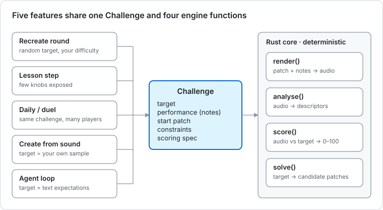
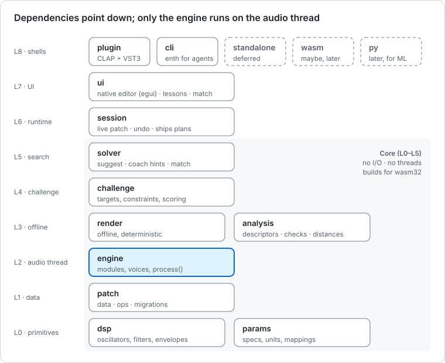

# Architecture

**One deterministic engine library, many thin front doors.** The plugin, the CLI, the tests, ML training and a possible future website all call the same pure-Rust crates. Dependencies only point down, and the core crates (L0–L5) build for `wasm32-unknown-unknown`.

## The core idea

Every feature reduces to four functions over one data format:

```rust
render(patch, performance, spec)  -> Audio        // deterministic: same inputs, same samples
analyse(audio)                    -> Descriptors  // what it sounds like, in numbers and words
score(audio, target, metric)      -> ScoreReport  // versioned, loudness-normalised
solve(target, constraints, start) -> Vec<Patch>   // sensitivity + search now, ML later
```

A **Challenge** (target + starting patch + constraints + scoring spec + performance) is the single object behind a lesson step, a Recreate round, a daily challenge, a duel, "create from sound" and the agent loop.



## Crate layers



| Layer | Crate (package name) | Responsibility | May depend on |
| --- | --- | --- | --- |
| L0 | `enth-dsp` | Oscillators (polyBLEP, wavetable), filters (SVF, ladder), envelopes, LFOs, smoothing, oversampling, effects (reverb, compressor; ported or in-house per [ADR-0006](adr/0006-effects-strategy.md)); `math` (the only door to `libm`) and `rng` (SplitMix64, `derive`, `fnv1a64`). No allocation in process paths. 2026-10-22 (R4 research, planned): `biquad` (lane BQ: an offline RBJ peaking and shelf biquad for R4's EQ games, coefficients through `math`, with its own golden and a note in `docs/dsp/`; a new file, so no existing output changes; S2's EQ module wraps it later) | — |
| L0 | `enth-params` | `ParamSpec` (kind, scale, flags), **units** (the unit tables and parser), value scales (plain ⇄ normalised, through pinned `libm`), display/parse ("800Hz", "40ms"); declared as `const` tables, checked at compile time | — |
| L1 | `enth-patch` | Patch model, module catalogue (descriptors), **edit ops** (`SetParam`, `AddModule`, `SetRoute`…) with inverses, the file layer (serde, schema version + migrations), validate, canonicalise, two hashes (exact and canonical), undo history | L0 |
| L1 | `enth-music` | *(created 2026-10-22 by lane S0e as compiling stubs, F0e; planned bodies from the R4 research)* Music theory and the ear generator: interval, chord, scale and progression tables (with simple voice leading), a 16-step rhythm grid and a syncopation measure, note names, and **ear generator v1** (an `EarSpec` → questions: notes, timbre ids, answer keys as seeded integers), frozen by a golden like generator v1. Pure, integers only, wasm32. It needs only `enth-dsp`'s `derive` and `fnv1a64`; it is L1 so that `enth-challenge` can embed its `EarSpec` and the UI and CLI get its labels without the challenge crate (an L0 crate could not use `enth-dsp`, and an L4 one could not be embedded by `enth-challenge`: same-layer edges are refused). Lanes MUS, then G1–G3 for the ladders ([ear.md](ear.md#where-r4-lives)) | L0 |
| L2 | `enth-engine` | Module implementations (enum-dispatched by role), voice manager, Patch → `RenderPlan` compiler, the 32-frame segment loop and host FIFO, real-time `process()`, plan swap with state carry | L0–L1 |
| L3 | `enth-render` | Offline deterministic render: (patch, performance, spec) → buffer | L0–L2 |
| L3 | `enth-analysis` | STFT/mel/MFCC, loudness, pitch, envelope and modulation estimates; **descriptors**; expectation checks; versioned distance metrics. 2026-10-21 (R3, provisional): `intake/` (lane FE: mono and trim, the noise floor, the bandwidth, clipped spans, the inferred performance; pure, wasm32) and `robust.rs` (lane OBJ: a degradation-aware distance under a new metric id, `sound/1` unchanged), both pre-declared as stubs by S0s | L0 |
| L4 | `enth-challenge` | `Challenge`, `Constraints`, `ScoringSpec`; evaluates a score (render + analysis). 2026-10-21 (R2 research, provisional): lessons moved up to `enth-learn` (L5), and this crate gains **Challenge v2** (lane CV2, judged at F1l: `Target::Draw`, `Target::Patch`, `Start::Patch`, `Constraints { editable, locked }` and `v2::touches`, the one table of what an op touches that every lock check shares, and the v1 migration; `Target::Expectations` and `AnswerKind::Choice` were left out, since a lesson's `Check::Sound` and `StepKind::Choose` say them), `prepare_patch_round` (moved down from `enth-cli`'s `compare.rs`) and lesson-only phrase ids ([challenge.md](challenge.md#challenge-v2-planned-lane-cv2-r2)). 2026-10-20 (R1 research; lane S0r creates the crate, [phase-2.md](phase-2.md)): the target generator (`random` and `priors`: keyed streams, the observability mask, the minimum step, reachable values; [design.md §9](design.md#9-randomizer-and-difficulty)); the phrase table; `RandomSpec` and challenge codes (`model`, `code`: Crockford base32 carrying the generator and engine versions and a target-hash prefix); scoring (`score/`: the `Scorer` trait and a versioned `ScoreReport`, the sound, structure, combined and time scorers, the module matcher, per-challenge calibration, and an in-house BS.1770 loudness on `libm` so sound % is bit-exact across platforms, [ADR-0007](adr/0007-metric-v1.md)). Pure like every core crate: no I/O, threads or clocks, and renders go through a caller-supplied evaluator, as in the solver. 2026-10-22 (R4 and R5 research, planned): **Challenge v3** (lane CV3, judged at F1e: `Target::Ear(EarSpec)` from `enth-music`, `AnswerKind::{Choice, Value, Taps}`, `ear.rs` and the frozen timbre pool `timbres-v1/`, the scorers `ear/1`, `ear-value/1` and `taps/1`, the ear-challenge code kind; [challenge.md](challenge.md#challenge-v3-planned-lane-cv3-r4)); `result` and `answer` (lane RC: the scorecard, the answer code and the ear result behind code v1's version-15 escape, the frozen `result-params-v1` table, paste-anything decoding, the daily formula; [challenge.md](challenge.md#version-15-the-kinds-behind-the-escape-r4-r5-planned)) and `verify` (decode, regenerate the challenge, apply the answer's ops and check the hash, re-score with the named scorer set, compare with the claim; [duels.md](duels.md#verification)) | L0–L3 |
| L5 | `enth-solver` | **P1a: `hint` only**, the multi-parameter fix behind `check` and `step` (it needs render and analysis, which are both L3, so it can live in neither of those crates nor in the CLI). Then sensitivity (`suggest`, coach hints), CMA-ES (`match`), nearest-solution search. Batch evaluation goes through a caller-supplied evaluator, so the solver itself spawns no threads. The evaluator must be **order-stable**: a work queue that writes each result by its input index, so results are identical for any worker count (measured: 1 and 8 workers give the same checksum). 2026-10-21 (R2 and R3 research, provisional): `closest` (R2, lane CLS: design §7's nearest passing patch from the player's patch, behind a "How close am I?" button); `create` (R3a, lane TP: the start portfolio, K branches whose ask batches merge into one pool batch, deterministic successive halving, `Candidate`), with `nearest` filled by k-NN retrieval over a pre-rendered bank; `propose` (R3b, lane ONX: our own scalar inference kernels and the model file's parser, bit-exact on every platform, weights passed in as bytes; this replaces the planned `onnx` feature and `tract`, [r3.md](r3.md#our-own-scalar-kernels-lane-onx)) | L0–L4 |
| L5 | `enth-learn` | *(created 2026-10-21 by lane S0l as compiling stubs, F0l; planned bodies from R2 research)* The lesson and pack model (`enth.pack/1`, `LessonRef`, compatibility), the pure lesson **player**, the four check kinds and their evaluation (patch predicates; sound expectations through `enth-render` and `enth-analysis`), progress and its merge, the markdown block AST (`pulldown-cmark`), the pack reader (`rawzip`, `miniz_oxide`, `sha2`), the deconstruct planner, coverage and the review boxes. Shared by the session, the CLI and the lesson tool (`tools/lesson`, driven by xtask). It embeds `Challenge`, so it sits above L4; it never calls `enth-solver` (same layer): solver jobs carry solver-native payloads the shell runs ([learn.md](learn.md#where-learn-lives)). 2026-10-22 (R4, built by lane DRL): the **drill player** ( `drill.rs`, the 3-down/1-up staircase, ear skills `ear.*` into Review's boxes through 5-item bursts, `StepKind::Drill` and the `drills` progress field, both additive, and the pure workout composer; [ear.md](ear.md#the-drill-player)) | L0–L4 |
| L6 | `enth-session` | Owns the live patch on the main thread: applies ops, undo/redo, compiles plans, ships them to the audio thread, bridges host params. P1b (2026-10-19): one `Session`, a single-threaded state machine (`&mut self`; no locks, threads, clocks or I/O) that owns the `Patch`, the `History`, the engine `Link` and the `PlanMap` of the latest plan it sent. The op's `effect()` decides between a value event, a depth event, a macro event and a recompile (`apply::route`); a transaction with any recompile is one plan. Its files are `model` (the `Session`, the editor's read model `SessionView` and edit trait `SessionEdit`, the `ShellRequest` outbox that the shell drains after unlocking, status and typed errors), `apply` (routing and delivery, gestures, edit, undo and redo through one `deliver`), `bridge` (the 72 host params, the "patch wins, write back only on a true difference" rule of [design.md §4](design.md#4-host-parameters-macros--automation-slots), host writes, slot names, rescan requests), `state` (the saved state v1: the `patch` and `enth` fields, migrations, the host-load history policy), `link` (activate, `pump`, epochs, bounded queues, audition notes) and `telemetry` (the tap's reader side). [session.md](session.md) has the API, the threading contract and the plan-delivery rules. A standalone or wasm shell could reuse it; the plugin adds the mutex. R1 and S1 (2026-10-20) add two modules: `game`, a pure round state machine (start, A/B, submit, give up, reveal, hints, an edit log stamped with times the shell supplies, the stash of the player's own patch; jobs such as target renders and scoring go out to the shell's worker and come back as results; lane SG), and `presets` (the format, exactly `Patch::to_json()`, with an index, tags and search; `load_preset` makes an editor preset load one undo step from `ops_between`, delivered like a load with no host writes; lane PBC). 2026-10-21 (R2 and R3 research, planned): `learn` (lane SL: binds `enth-learn`'s player to the live patch, stashes the player's patch, loads step starts, **refuses ops on locked addresses** in the edit path (`SessionError::Locked`), sends Learn jobs to the shell, and keeps the in-flight lesson in the `enth` field's optional `learn` object; a lesson's Recreate step is a game round through `RoundSource::Challenge`) and `create` (lane SK3: the "create from sound" state machine; jobs go out to the shell's create thread, candidates come back, and "Use this" is one undo step with no host writes). 2026-10-22 (R4 and R5 research, planned): `ear` (lane SE: ear questions go out as jobs, answers and taps come back with times the shell supplies; nothing is saved per project, as with Create) and `duel` (lane SE: a scorecard and an answer built from a round's first passing submit, and the Verify job; the round keeps the patch of its first pass, additive and within the round's budget) | L0–L5 (uses `enth-params`, `enth-patch`, `enth-engine` and, for `DEFAULT_SEED` only, `enth-render`) |
| L7 | `enth-ui` | Native editor (egui by default): `theme` (design tokens, [design-system.md](design-system.md)), widgets, module lanes, modulation rings, scopes, lesson and Recreate views. P1b (2026-10-19): the whole editor lives here, under `editor/`, because a separate editor crate would be same-layer and `check-layers` refuses that. `regions` holds the named regions (header, macros, card region, source tiles, matrix, status), each drawing into the rectangle it is given; `layout` is `LayoutSpec` (regions sized by tokens, loadable from JSON; lane ED1); `cards` generates a module card for every catalogue kind from its `ParamSpec`s, with the view-model built from the patch every frame, stable widget ids and the `Intent`s the controls push. Widgets emit intents; the editor turns them into ops through the session at frame end. The tokens are split per area under `theme/` ([design-system.md](design-system.md#token-files)). 2026-10-21 (planned): `editor/learn/` (lane LUI, feature `learn`: the lesson pane, the overlay's highlight and lock, the lesson browser) and `editor/create/` (lane PUI: the drop zone, the folder browser, the K candidate tiles, progress and cancel), each behind its header hook. 2026-10-22 (R4 and R5, planned): `editor/ear/` (lane EUI, feature `ear`: the Ear view, a right column like Create's and exclusive with it, every round type, workouts, thresholds per skill) and the duel card `editor/duel/` (lanes SKD and DUI, feature `duel`: the share line, the paste box, verification, the sealed answer, the local duel history), with `sizes/ear.rs` and `sizes/duel.rs` | L0–L6 |
| L8 | `enth-plugin` | CLAP/VST3 shell: host params (macros + slots), state, notes, poly-mod, editor embedding. P1b (2026-10-19): a `cdylib` + `lib` on nice-plug, with its files declared by S0b and filled by the lanes that own them: `params` (the 72 host params with permanent string ids, lane SK), `process` (the audio block: host events in as engine events, the engine, audio out; SK, PL), `notes` (the note tuple, `NOTE_END`, voice info and poly-mod with voice ids from `VoiceID::id()`; PL), `state` (two persistent fields, `patch` as the exact patch JSON and a versioned `enth` blob; SK) and `editor` (the `NiceEguiApp` window around the `enth-ui` editor; SK, ED1). The shell holds the one session mutex. It translates and nothing more. Details: [plugin.md](plugin.md). 2026-10-21 (planned): `learn` (lane SKL: pack I/O, the per-user progress file, Learn jobs on the game worker) and `create` (lane SK3: the `enth-create` thread, a per-job rayon pool, the audio decoders, the model-file lookup). 2026-10-22 (R4 and R5, planned): `ear` (lane SKE, feature `ear`: ear jobs on the game worker, examples at the host's rate, a "play from the top" flag on the Target ▶ loop; lane TAP the tap path, editor stamps first and a host-MIDI ring on the audio thread only with the owner's OK) and `duel` (lane SKD, feature `duel`: duel jobs, the clipboard written on a click and read only on Paste; DUI the duel history file). No networking code | L0–L7 |
| L8 | `enth-cli` | The `enth` binary for humans, scripts and agents; supplies parallelism (e.g. rayon) to the solver. 2026-10-22 (planned): `enth ear` (lanes SKE and EV4) and `enth duel result\|verify` (lane SKD) | L0–L5 |
| L8 | `enth-standalone` | *(waits for the owner's OK, 2026-10-20)* A desktop app on nice-plug's `standalone` feature, for R1's friend build (Logic users, friends with no DAW): the same editor, with the patch, settings and game progress saved to the user's data folder (nice-plug's wrapper saves nothing). It pulls `cpal`, `midir` and, on Linux, `jack`, system libraries that need the owner's OK ([AGENTS.md](../AGENTS.md#choosing-libraries)); a trial crate compiled for Linux, Windows and macOS and passed `cargo deny` (R1 research, report 04). `xtask/layers.toml` has no line for it yet: one is added when it is approved | L0–L7 |
| L8 | `enth-wasm` | *(later, maybe)* browser build | L0–L7 |
| L8 | `enth-py` | *(later)* Python bindings for ML datasets. 2026-10-21: R3b may need it to hand `enth-analysis` features and batched renders to `ml/`, or `tools/datagen` may write files instead; lane DG decides at F3s, and the crate gets its `xtask/layers.toml` line when created | L0–L5 |

Tooling is outside the layer system and listed as exempt in `xtask/layers.toml`: `xtask`, `enth-test-host` (`tools/test-host`), `enth-golden` (`tests/golden`), `enth-listen` (`tools/listen`, the listening tools), `enth-lesson-tool` (`tools/lesson`, the lesson tooling: `check`, `coverage`, `new`, `pack`, `gen`, which holds the `enth-learn`, `enth-session`, `enth-solver` and `enth-challenge` dependencies so that `xtask` stays light, and which `cargo xtask lesson-check` and friends drive; R4 adds `ear-check` there (`src/ear/`, a stub by S0e; lane ECK), driven by `cargo xtask ear-check`, with oracle, random and deaf players, audibility per level and the ear generator's golden) and everything named `spike-*` (`spikes/`). `enth-datagen` (`tools/datagen`, created by S0s as stubs: TP's k-NN bank builder, which `cargo xtask bank` drives, and R3b's `ds1`, shards and exclusion check; it holds the engine-bound dependencies so that `xtask` stays light) is exempt too. R3b adds `tools/model-check` (parity of our kernels against ONNX Runtime and `tract-nnef`), planned. `enth-golden` is the golden-render harness, built in P1a: cases are text files read at run time (`tests/golden/cases/*.toml`, one per case), one hash per case valid on every platform, every mismatching case reported in one run with a summary diff, and `--update` refused under CI.

### Rules that keep it refactor-free

1. **Dependencies point down only.** `xtask/layers.toml` is the single source of truth for layers. `cargo xtask check-layers` reads `cargo metadata` and fails on an upward or same-layer edge, or on a workspace member that is neither layered nor exempt.
2. **Core crates (L0–L5) do no I/O**, spawn no threads, read no clocks, use no locks, use no global RNG, and must build for `wasm32-unknown-unknown` (`cargo xtask wasm-check`). Parallelism and I/O are supplied by the caller. `wasm-check` proves only that they *build*: a wasm32 build accepts `Instant::now`, `fs::read` and `thread::spawn`. The root `clippy.toml` (`disallowed-methods`, `disallowed-types`) is what bans them; shell crates and tooling opt out.
3. **Only `enth-engine` runs on the audio thread.** Its `process()` never allocates, locks, logs, does I/O or panics.
4. **Descriptors in `enth-patch`, implementations in `enth-engine`.** The UI, challenges, solver and CLI reason about modules (names, ranges, units, tiers) without linking DSP. `ModuleImpl::new` is an exhaustive `match` on `ModuleKind`, so a descriptor without an implementation is a compile error, not a failing test.
5. **Every change to a patch is an op.** The UI emits ops, the CLI applies ops, undo stores inverse ops, a future network duel would send ops. There is no second way to mutate a patch.
6. **Shells translate; they never decide.** No product rule lives in `enth-plugin` or `enth-cli` — it would be missing from the next shell.
7. **Everything persisted or sent is versioned** (patch, challenge, lesson, CLI JSON output) and has fixture tests.

## Threads and data flow inside the plugin

| Thread | Owns | Talks to others via |
| --- | --- | --- |
| Audio (host-owned) | `RenderPlan`, voices, smoothed param values | Receives plans and epoch-tagged value events in order from one `rtrb` command ring; returns old plans on a return ring that has a pending slot, so nothing is freed on this thread; writes the read-only telemetry tap (atomics: modulated values, modulator outputs, voices, peaks, a scope ring); at most every 50 ms, and only while a compile is pending, asks nice-plug to run the pump task on its background worker |
| Host main | The plugin's `activate`, `deactivate`, state save and load, parameter-info queries; calls into `enth-session` (live `Patch`, undo stack, **plan compilation in P1**) | Locks the session mutex; sends compiled plans and value events down; drains the return ring |
| GUI (baseview's X11 thread in 0.4.1) | `enth-ui`, the editor's `ParamSetter` gestures | Locks the same session mutex; reads the telemetry tap; host param changes arrive as events |
| nice-plug's background worker (`bg-worker`) | Nothing of its own. Its one task is the session pump: it takes the session lock, calls `Session::pump` (takes retired plans back, sends a compile left pending) and unlocks | Scheduled from `process()` through `execute_background`, rate-limited, only while a compile is pending; takes the session mutex ([session.md](session.md#plan-delivery-and-who-drains-the-return-ring)) |
| Game worker (R1, 2026-10-20; later also analysis) | A Recreate round's jobs: the target render, scoring after edits settle, coach hints; later solver runs. Plan compilation stays where it is (about 0.9 ms for the G1 patch) | Takes jobs from the session's `game` module and posts results back to it under the session mutex; the editor never waits on it, so a stalled scorer still gets frames. The rendered target reaches the audio thread preallocated, never allocated there |
| Create thread and its pool (R3, planned 2026-10-21) | A "create from sound" job: decoding, the intake, features, inference (R3b, one thread, milliseconds) and the K searches, on a per-job `rayon` pool (`enth-search-N`, `min(cores/2, 8)` workers, normal priority) dropped when the job ends. Separate from the game worker, which is joined on drop and could not hold a 60 s search | Takes jobs from the session's `create` module and posts candidates back like the game worker, never computing under the session lock; cancel is an atomic checked per evaluation batch; gated by `process-stats --gate g1` while a job runs ([r3.md](r3.md#the-cancellable-pool-lane-sk3)) |

- **Value change** (knob, automation, macro): a parameter event, smoothed on the audio thread. No recompilation.
- **Structural change** (add module, add route): `enth-session` compiles a new `RenderPlan` under its lock, on whichever non-audio thread made the edit or pumps (the GUI thread, the host main thread or the background worker; P1 patches are small, about 0.9 ms for the G1 patch, [session.md](session.md#threading-contract)), sends it through the command ring, the engine swaps it at a segment boundary, and sends the old plan back to be dropped. State is carried over for every module whose ID and kind survive (moved, not copied, at an instant swap); only added or removed modules crossfade ([design.md §3](design.md#3-engine-and-real-time-safety)). The `PlanMap` (address → parameter index) stays in the session, never on the audio thread, where an op becomes a value event or a recompile.
- **Editor closed:** no timers, no repaint, no analysis. The UI costs nothing.
- **Threading contract (P1b, 2026-10-19).** The full text is in [session.md](session.md#threading-contract) (lane S1s); the rules are:
  - The session is one mutex-wrapped value shared by the host main thread, the GUI thread and nice-plug's background worker (the pump task). In baseview 0.4.1 the first two are different threads (until baseview PR #357 lands, which moves the X11 work to the main thread; the mutex stays correct either way). The audio thread never touches the session, and nothing is locked from `process()`.
  - The audio thread owns the `Engine`, a preallocated event buffer and the last host values it saw. Host automation reaches the engine there as slot events; the session folds it into the patch later, and only when it truly differs ([design.md §4](design.md#4-host-parameters-macros--automation-slots)).
  - Never call `GuiContext::set_state` from the editor while processing (nice-plug would load that state on the audio thread), and never schedule GUI work (`execute_gui`) from `process()`. The one task `process()` may schedule is the rate-limited pump above, through `execute_background`.
  - **Who drains the return ring** is settled in [session.md, "Plan delivery"](session.md#plan-delivery-and-who-drains-the-return-ring): the session itself, at its next entry (an edit, undo, redo, a state save or load, `activate` and once per editor frame all pump first), so no timer runs while the editor is closed. A compile left pending when nobody calls the session is sent by the background pump, with no fork patch.
  - The editor depends on a narrow session trait, not on the plugin, so kittest, the dev window and the plugin run the same editor code.

## Folder topology

Directory names match package names: `crates/enth-dsp` is the package `enth-dsp` (2026-10-19: the earlier short directory names, such as `crates/dsp`, were dropped).

```
enth/
├── Cargo.toml              # virtual workspace: members (crates/*, xtask, tests/golden, three spikes, tools/*), default-members, [workspace.package], [workspace.lints]; P1b adds [patch.crates-io] for vendor/ and excludes vendor/ and the retired spikes
├── rust-toolchain.toml     # pinned stable toolchain (1.99.1) + wasm32 targets
├── clippy.toml             # lint options: bans I/O, clocks, threads and locks in core crates
├── .cargo/config.toml      # [alias] xtask = "run --package xtask --"
├── .github/                # workflows/ci.yml, dependabot.yml
├── deny.toml               # cargo-deny: allowed licences, banned crates
├── LICENSE                 # MIT
├── THIRD_PARTY_NOTICES.md  # one entry per ported source: upstream, commit, licence, copyright
├── AGENTS.md               # agent rules (the single copy)
├── CLAUDE.md               # "Read AGENTS.md and docs/README.md before any task."
├── _local/sessions/        # research sessions: <YYYY-MM-DD>-<slug>/{brief,NN-topic,summary}.md (committed; see research-process.md)
├── docs/                   # these docs; docs/adr/ decisions; docs/dsp/ one note per module; docs/spikes/ results
├── crates/                 # directory name = package name
│   ├── enth-dsp/           # L0  src/{math,rng,…}.rs: the only libm door; one file per DSP core (osc, svf, reverb, …); biquad.rs (R4, BQ; a stub by S0e)
│   ├── enth-params/        # L0  src/{spec,units,scale,parse,display,macros}.rs (units live here)
│   ├── enth-patch/         # L1  src/{model,catalogue/,addr,validate,ops,wire,history,file,migrate,canon}.rs (the files today; S1b may add more)
│   ├── enth-music/         # L1  R4 (created by S0e as stubs, F0e; MUS fills it, G1–G3 and TAP the ladders): src/{theory,rhythm,ear}.rs and ladder/: theory tables, rhythm, the frozen ear generator v1 and its golden
│   ├── enth-engine/        # L2  src/{module,params,plan,voice,engine,link}.rs, modules/{generators,modulators,effects}/
│   ├── enth-render/        # L3
│   ├── enth-analysis/      # L3  src/{features,descriptors,expect,distance}.rs; intake/ (R3, FE) and robust.rs (R3, OBJ), stubs by S0s
│   ├── enth-challenge/     # L4  R1 (created by S0r): src/{model,code,random,priors,phrase,score/}.rs: challenges and codes, the generator, the scorers; R4, R5 (stubs by S0e, F0e): v3.rs, ear.rs and ear/ with timbres-v1/ (CV3; ear/ladder.rs is G4's), result.rs (the version-15 kind numbers are reserved), answer.rs, verify.rs, paste.rs, daily.rs (RC)
│   ├── enth-solver/        # L5  src/{search,heuristic,sensitivity,cmaes,nearest,coach,eval}.rs, hint/, search/; closest.rs (R2; a stub by S0l), create/ (R3a, TP; a stub by S0s; nearest.rs becomes k-NN), propose/ (R3b, ONX; a stub by S0s)
│   ├── enth-learn/         # L5  R2 (created by S0l as stubs; LM, PLY, LCK, DEC and REV fill them): src/{pack,store,reader,lesson,check,predicate,player,progress,markdown,coverage,deconstruct,review,error}.rs: lessons, packs, the player, checks, progress, markdown, deconstruct, review; drill.rs (+ drill/{staircase,record}.rs) and workout.rs (R4, DRL; stubs by S0e)
│   ├── enth-session/       # L6  src/{model,apply,bridge,state,link,telemetry}.rs: the Session (patch, history, link, plan map), the host-param bridge, state; R1/S1 add game.rs and presets.rs; R2 adds learn.rs (a stub by S0l, which also reserved the `enth` field's `learn` object); R3 adds create.rs (a stub by S0s; a create job is not saved, so no state field); R4 and R5 add ear.rs and duel.rs (SE; stubs by S0e, with no state field)
│   ├── enth-ui/            # L7  src/{theme/,widgets/,editor/{regions,layout,cards,recreate,…},gallery}; editor/learn/ (R2; the header's Learn hook and stubs by S0l, behind `learn`), editor/create/ (R3; the header's Create hook and stubs by S0s, behind `create`); editor/ear/ (R4; the header's Ear hook and stubs by S0e, behind `ear`) and editor/duel/ (R5; the duel card's seam and stubs by S0e, behind `duel`)
│   ├── enth-plugin/        # L8  src/{params,process,notes,state,editor,game,presets,…}.rs: CLAP (+VST3) shell; cdylib + lib; learn.rs (R2, behind the `learn` feature; a stub by S0l), create.rs (R3, behind the `create` feature, which brings the audio decoders and rayon; a stub by S0s); ear.rs and duel.rs (R4, R5, behind `ear` and `duel`; stubs by S0e, with inert hooks in `editor.rs`)
│   ├── enth-cli/           # L8  the `enth` binary
│   ├── enth-standalone/    # L8  waits for the owner's OK (R1's friend build); created when approved
│   ├── enth-wasm/          # L8  later — created when needed
│   └── enth-py/            # L8  later — created when needed
├── content/
│   ├── presets/            # *.patch.json: Init, the owner's G1 four (`cargo xtask extract-presets`: the plugin's saved patch, named after its track) and the picked factory presets in <type>/ folders
│   ├── templates/          # constrained patch templates for games, ML and agent starts
│   ├── lessons/            # PLAN.md (the R2 curriculum), LICENSE (provisional content terms) and `example/` (a tiny pack that shows the layout; S0l); planned: one folder per pack (basics, shaping, space-and-dynamics, studies): TOML + markdown + patches,
│   │                       # built into .enthpack files (enth.pack/1) by `cargo xtask pack` and bundled; targets rendered on the fly (learn.md)
│   ├── agent-evals/        # goals/*.toml + prompts (agent benchmark; P1a: 10 starter text goals, R1: more goals and reference sounds)
│   ├── gr1/                # GR1's codes and the CMA-ES floors
│   └── gr3/                # R3 (README and empty placeholders by S0s; lane DS fills them): the held-out sets' manifests, hashes and exclusion lists; planned: runs.jsonl (EVK); audio only when CC0 or the owner's
├── tests/golden/           # the `enth-golden` crate (it needs both L3 crates and `check-layers` rejects same-layer edges, so it is exempt): reference patches, expected hashes (one per case, valid on every platform; per-platform overrides only where a platform has not run yet) and feature summaries as text — no WAVs in git
├── spikes/                 # Phase 0 throwaway code (spike-* packages, exempt from layers). Members: spike-metric (tools/listen uses it), spike-engine
│                           # (`cargo xtask wasm-hash`, the engine-golden workflow), spike-agent (the probe CLI). spike-shell, spike-ui and spike-ui-plugin
│                           # left the workspace in P1b lane INT: their source stays as the evidence docs/spikes/ links to, frozen, and no longer builds
├── scripts/                # gate.sh lane|full: the two merge gates, judged by exit status only
├── tools/
│   ├── test-host/          # enth-test-host: tiny CLAP host (clack-host): scripted editor open/close, timings; P1b adds --state loading, cli-equal, instance churn, event bursts, NOTE_END checks, process-stats and knob-to-sound latency
│   ├── listen/             # enth-listen: the owner's listening tests (metric pairs, ABX, real-engine pairs); gr3 (R3 clause 2, friend kits; a hidden stub by S0s, lane LT builds it)
│   ├── lesson/             # enth-lesson-tool (R2, created by S0l as stubs; LCK, DEC and INT2 fill them): the lessons' authoring loop, driven by `cargo xtask lesson-check|lesson-coverage|lesson new|pack|lesson-gen`; `gr2-report` reads its files in xtask itself; ear-check (R4, ECK; planned)
│   ├── datagen/            # enth-datagen (R3, exempt; created by S0s as stubs): bank.rs (TP, the k-NN bank, driven by `cargo xtask bank`), ds1.rs, shards.rs, exclude.rs (DG, R3b)
│   └── model-check/        # planned (R3b, exempt): our kernels against ONNX Runtime and tract-nnef; exact output hashes
├── vendor/                 # P1b: nice-plug, nice-plug-core, nice-plug-egui, baseview, egui-baseview from crates.io with our patches, behind [patch.crates-io]; not workspace members; lint-capped; edited only by lane FK
├── ml/                     # R3 (skeleton by S0s: pyproject.toml, no dependency, no lock): Python (uv): enth_ml/{degrade,augment,model,train,export}; the degradation chain, augmentation, training, ONNX export to our model file; never shipped,
│                           # in no cargo or CI build (the root manifest excludes it, ci.yml ignores it); LGPL/GPL tools (LAME, ffmpeg) only as subprocesses here; MIT or Apache code only
└── xtask/                  # layers.toml; commands: check-layers, wasm-check, bundle, install, reaper-test, host-render, wasm-hash;
                            # P1a adds golden, bench and agent-eval; P1b adds validate (the pinned clap-validator 0.4.1), affected (the crates a change
                            # touches plus their dependants, which gate.sh lane tests) and a --package option for bundle, install, validate, host-render and reaper-test;
                            # lane INT adds leak-test (editor-cycles and instance churn under Xvfb), extract-presets and starter-project, and host-render runs cli-equal;
                            # R2 (S0l) pre-declares lesson-check and friends, thin drivers of tools/lesson; R3 (S0s) gr3-run and gr3-report (EVK) and bank (TP, a driver of tools/datagen);
                            # R4 (S0e) ear-check (ECK, a placeholder that passes and later a driver of tools/lesson) and gr4-report (INT4, refuses to run)
```

## Vendored crates (P1b)

2026-10-19, from the P1b research. nice-plug, nice-plug-core, nice-plug-egui and baseview (and egui-baseview, for the focus patch) are carried in the repo under `vendor/`, not as a git fork. The patches and the reasons are in [ADR-0001](adr/0001-plugin-shell.md#note--2026-10-19-p1b-research-the-vendored-fork-and-the-nice-plug-pitfalls).

- **Behind `[patch.crates-io]`.** The workspace excludes `vendor/`, and each vendored crate keeps its version, so the exact `=` pins still match. The files come from the crates.io `.crate` files that `Cargo.lock` pinned; `vendor/README.md` records the versions, the sha256 sums, the patch list and the upstream status.
- **Why not a git fork.** A public fork would have exposed the project name while the repo was private (it is public since 2026-10-20), CI would depend on Codeberg being up, and `deny.toml` would need `allow-git`.
- **Patches.** Five, one commit each: a runtime display name for parameters with a main-thread CLAP rescan (slot rename), `editor_closed()` called when the editor window is destroyed, baseview's `xkb_keymap_unref`, keyboard focus only while a text field is edited, and a CLAP fix for a note-on listed ahead of a parameter change on the same frame (found by lane TH). `vendor/README.md` has the list with the upstream status; the measurements are in the ADR-0001 note for lane FK.
- **History.** A pristine-import commit, the ISC licence files, the lint cap, the `[patch.crates-io]` block, then one commit per patch and the test harnesses (`vendor/tests/`), so a re-import after an upstream release is a rebase.
- **Ownership.** Only the fork lane (FK) edits `vendor/`. The coordinator edits `[patch.crates-io]` in one commit.
- **Lints.** Cargo caps lints in registry dependencies but not in path dependencies, and `[patch.crates-io]` turns these five crates into path dependencies, so a warning in them would fail CI under `CARGO_BUILD_WARNINGS=deny` (clippy's `-D warnings` and `cargo fmt --check` skip `vendor/`). Pristine nice-plug 0.4.2 already warns in release builds (two variables used only in a debug assertion). Each vendored `Cargo.toml` therefore ends with `[lints.rust] warnings = "allow"` (lane FK), which gives them what a crates.io dependency gets, with no source edit. A hard error from a toolchain bump is not covered and needs a patch.
- **Licences.** The nice-plug crates declare ISC but their packages carry no LICENSE file, so the ISC text is copied from the Codeberg tag. baseview and egui-baseview are `MIT OR Apache-2.0` with both files present. Each gets a `THIRD_PARTY_NOTICES.md` entry.

## Light and heavy builds: content packs and features

- **Lessons are data, not code.** A content pack is a folder (or archive) of `lesson.toml`, markdown and patches. Packs can be bundled, or downloaded on demand from the project's GitHub releases with a button — plain file downloads, no server of our own.
- **2026-10-21 (R2 research, provisional): bundled first, no network code in R2.** A pack is an `.enthpack` zip (or a folder with the same layout) with a JSON manifest, `enth.pack/1`, listing every file's SHA-256; authors write TOML and `cargo xtask pack` builds it reproducibly. First-party packs are embedded in the build (about 0.2 MB for 60 lessons), dropped packs live in `<Documents>/enth/Packs/`, and a "Get more lessons" button opens the releases page in the browser. In-plugin download (`ureq` + `rustls`, behind a non-default `learn-download` feature in L8 only) waits for GR1 and the owner's OK, because both `rustls` crypto providers bring a C toolchain or a very new crate ([learn.md](learn.md#packs)). An R3b model file is delivered the same way, as a plain file beside the plugin ([r3.md](r3.md#the-model-file)).
- **Views behind cargo features.** `enth-ui` puts the Learn and Recreate views behind features (`learn`, `recreate`), so a lean build is a flag, not a refactor. R2 adds an `enth-plugin/learn` feature for the I/O and the bundled packs; `enth-learn` and `session::learn` always compile, so a saved lesson restores in any build. R4 and R5 (lane S0e, F0e) add the features `ear` and `duel` in `enth-ui` and `enth-plugin`, off by default until their skeleton lanes decide (F2e, F2d); `enth-music`, Challenge v3, the result codes and `session::{ear, duel}` always compile, so a build without the views still reads every code.
- Nothing in the engine or patch format depends on whether those features are compiled in.

## Modules as their own plugins (ideal)

Kilohearts-style: an effect from the synth could also ship as its own small plugin. To keep this possible without committing to it:

- A module's DSP depends only on `enth-dsp` and its `ParamSpec`s — never on engine internals such as the voice manager or plan compiler.
- If it's ever wanted, module code moves into its own crates (`crates/modules/<name>`) below `enth-engine`, and a tiny generic shell wraps any one module as a CLAP effect.

## Adding a feature: the predictable path

A new oscillator, for example:

1. DSP primitive in `crates/enth-dsp` with unit tests.
2. Descriptor (params, units, ranges, lesson metadata) in `crates/enth-patch/src/catalogue`.
3. Implementation in `crates/enth-engine/src/modules/generators`.
4. Golden render test in `tests/golden`.
5. Module card in `crates/enth-ui`.
6. It's automatically available to the CLI (`enth modules`, `enth apply`) because the CLI reads the catalogue.
7. At least one lesson in `content/lessons` and one agent eval in `content/agent-evals`.

Nothing else changes.
