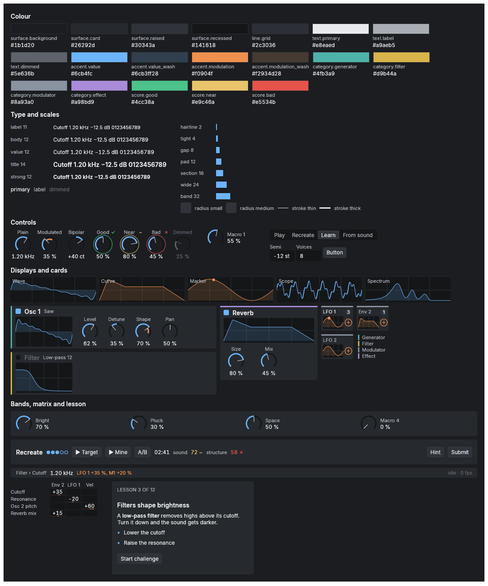
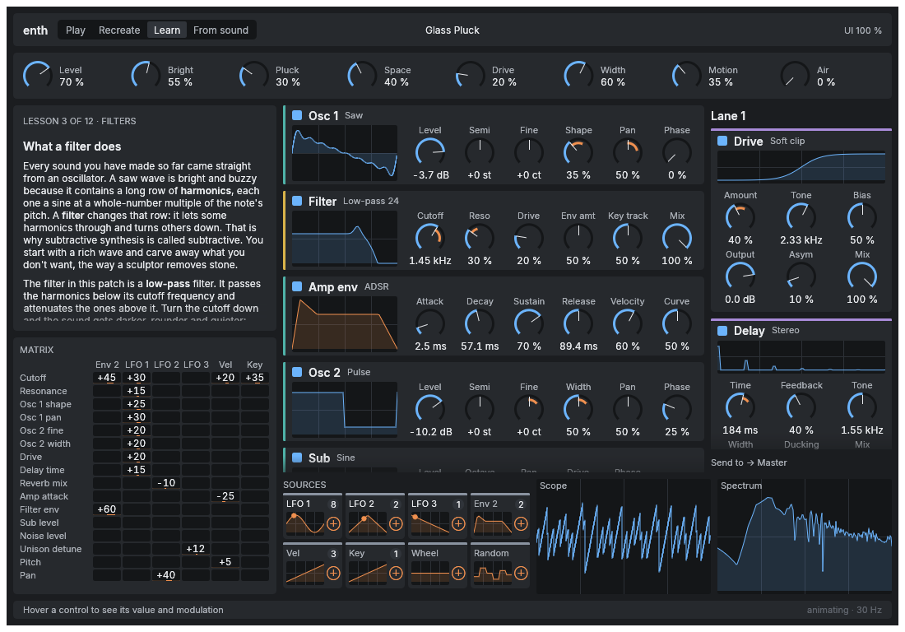
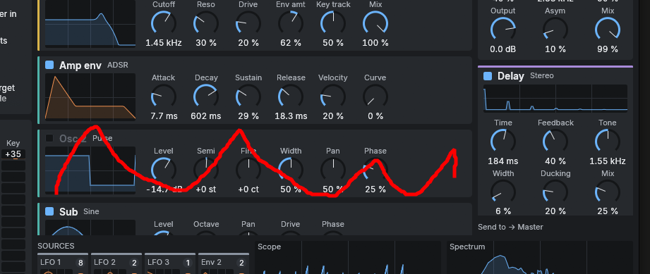
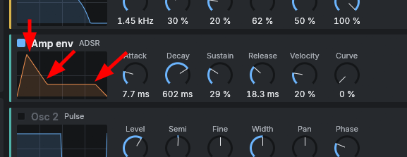

# Handoff: enth editor layout exploration

**For:** Claude Design, or any designer.
**From:** the enth owner and coordinator, 2026-10-19.
**Ask:** explore **alternative layouts** for the synth editor: where modules sit, how the eye scans, how information is grouped.
**Keep:** the visual language. The owner likes it as it is: colours, knobs, buttons, LFO tiles, type.

## 1. What enth is

enth is a modular software synthesizer: a CLAP/VST3 plugin with a native UI, Rust + egui, no web view. It's built around three ideas:

- **Play:** a Phase Plant-style structured modular synth. Sound sources → filter → effects, with drag-to-modulate anything, 8 macros and a modulation matrix.
- **Recreate:** a game. The synth generates a random patch, you rebuild it by ear, and you get scored on sound, structure and time.
- **Learn:** Syntorial-style lessons from "what is a saw wave" to sound design, on the same instrument.
- **From sound** (later): drop in a sample and get editable patch candidates back.

The first version (P1) is a small, Syntorial-sized instrument. The layout has to work at that size and grow to the full modular limits without a redesign.

## 2. What to keep (don't change)

- **Palette and tokens.** Dark neutral greys; **blue = value**, **orange = modulation**; category stripes (generator teal, filter yellow, modulator grey, effect purple); score colours green / yellow / red, always with a glyph (✓ ~ ✗). Exact values are in [`docs/design-system.md`](../design-system.md).
- **Components:**
  - the knob, with a value arc, a modulation arc and an amount handle;
  - module cards, with a stripe, an enable toggle, a title with a type dropdown, a live display and a parameter grid;
  - LFO and envelope source tiles, with a live mini-graph, a route-count badge and a ⊕ drag handle;
  - the segmented buttons, the scope and the spectrum.
- **Feel:** flat, minimal, no gradients, shadows or skeuomorphism. Inter type, title case, tabular digits for values.

## 3. What's off (the owner's words, plus our hypotheses)

The owner: *"The design is awesome. The scannability, information architecture and module placement is off."*

Our hypotheses about why. Please test them rather than take them as given:

1. **The signal flow doesn't read.** The middle column mixes kinds in an odd order: Osc 1 → Filter → Amp env → Osc 2 → Sub. A filter sits between two oscillators, and an envelope sits among the sound sources.
2. **Modulators are split.** Envelopes live in the generator column; LFOs, velocity and key live in a strip at the bottom.
3. **Two unrelated things share the left column.** The lesson pane, which is only for Learn mode, and the modulation matrix, a secondary overview, both take prime space.
4. **Everything has equal weight.** There's no focal point, so the eye has nowhere to land first.
5. **The effects lane is cramped** at the right edge, and "Send to → Master" is an afterthought.
6. **The scope and spectrum** compete with the source tiles in the bottom row.
7. **The generator column scrolls** (Sub is cut off) while other regions have spare space.
8. **The macro bar** spans the full width with large knobs, more emphasis than its role may deserve.

Note: the current panel is a *benchmark slice*, so it shows Drive and Delay effects. P1's real effects are **Compressor** and **Reverb**.

## 4. Interaction changes already decided

These are being implemented now. Assume them in every variant.

- **A disabled module dims as a whole** (card, display, knobs, values), not just its name. 
- **Envelope curves are directly editable:** drag the attack peak, the decay/sustain point and the release end on the curve, as an alternative to the knobs, kept in sync both ways. LFO curves may follow. 
- **Drag-to-modulate:** drag a source's ⊕ onto any knob. Valid targets highlight while dragging, and the knob shows an orange depth arc.

## 5. Content inventory (what must fit)

**P1 module set.** Default patch in brackets; maximum in the second column.

| Region / module | P1 default | Max | Parameters per module |
| --- | --- | --- | --- |
| Header: mode tabs (Play / Recreate / Learn / From sound), preset name, undo/redo, UI scale | 1 | 1 | — |
| Macros | 8 | 8 | 1 knob + label each |
| Oscillators (`osc`: wave, semi, fine, level, pulse width, sync, table, position, plus 3 advanced phase params) | 2 | 4 generators total | ~8 visible + 3 advanced |
| Noise (color, level) | 1 | (shares the 4) | 2 |
| Filter (`svf`: mode, cutoff, resonance, keytrack, drive) | 1 | 4 per-voice effects | 5 |
| Envelopes (`adsr`: attack, decay, sustain, release, velocity); one is the amp envelope | 2 | 8 modulators total | 5 + curve |
| LFOs (shape, rate, polarity, scope, plus phase params) | 2 | (shares the 8) | 4 + 3 advanced |
| Fixed sources: velocity, key, mod wheel, macros 1–8 | — | — | — |
| Modulation overview: matrix grid (sources × targets) or list | 1 | up to 64 routes | — |
| Effects: Compressor (threshold, ratio, attack, release, knee, makeup, mix), Reverb (dry, wet, room, decay, early, detune, low/high cut, low/high damp) | 2 | 4 global effects | 7 and 10 |
| Voice settings: mode (poly / mono / legato), polyphony, glide, glide mode, pan | 1 | 1 | 5 |
| Master level | 1 | 1 | 1 |
| Scope and spectrum | 2 | — | — |
| Status / help line (hovered parameter, value, its modulations) | 1 | 1 | — |
| **Learn:** lesson pane (markdown, steps, "Start challenge"); dims controls the step doesn't use | — | — | — |
| **Recreate:** challenge bar (difficulty, Target ▶ / Mine ▶, A/B, timer, live scores, Hint, Submit); a results drawer (scores, per-control rings with ✓ ~ ✗ and arrows, next actions); a randomizer settings page | — | — | — |
| **From sound** (later): target waveform plus candidate cards (audition, score, "Open in editor") | — | — | — |

## 6. Constraints

- **Native immediate-mode UI (egui).** Fixed card heights and fixed column widths are cheap; content-sized layouts and free canvases cost more. No cable canvas as the main view.
- **Window:** 1200 × 800 logical px by default, resizable down to about 1000 × 680; UI scale 75–200 %. Plugin hosts give a fixed-size window that the user can resize.
- **Animation:** at most about 30 fps, only for visible, changing things (scopes, live tiles, rings).
- **Sizes on a 4 px grid**, using the existing tokens: knob 36 px in a 56 px cell, header 40, status line 22, card title 14 semibold, labels 11–12 px.
- **Dark theme only in v1.**
- **Accessibility:** contrast ≥ 4.5:1 for labels and ≥ 7:1 for values; colour is never the only signal.

## 7. What we'd like back

1. **3–5 layout variants.** For each:
   - an annotated wireframe;
   - a hi-fi mock in the existing visual language;
   - the main regions with sizes in logical px (so it maps to code);
   - the intended **scan path** (what the eye hits first, second, third) and how the signal flow reads;
   - **where modulation sources sit relative to their targets** for drag-to-modulate;
   - how it handles the **P1 default patch** *and* the **maximum** (4 generators, 4 per-voice effects, 4 effects, 8 modulators), with no scrolling at P1 size if possible;
   - how **Recreate**, **Learn** and **From sound** adapt: what appears, what dims, what moves.
2. **A recommendation**, with its trade-offs.
3. **Open questions** for the owner.

Directions worth trying (not prescriptive):
- **A.** Strict left-to-right signal flow: sources → filter → amp → effects → out, with modulators in a dedicated band.
- **B.** A "focus + overview" layout: one large focused module and a compact map of the rest.
- **C.** A fixed teaching-style panel at P1 size that expands into lanes.
- Anything better.

## 8. Non-goals

- New colours, knobs or visual style.
- A node/cable canvas as the main view.
- Web technologies.
