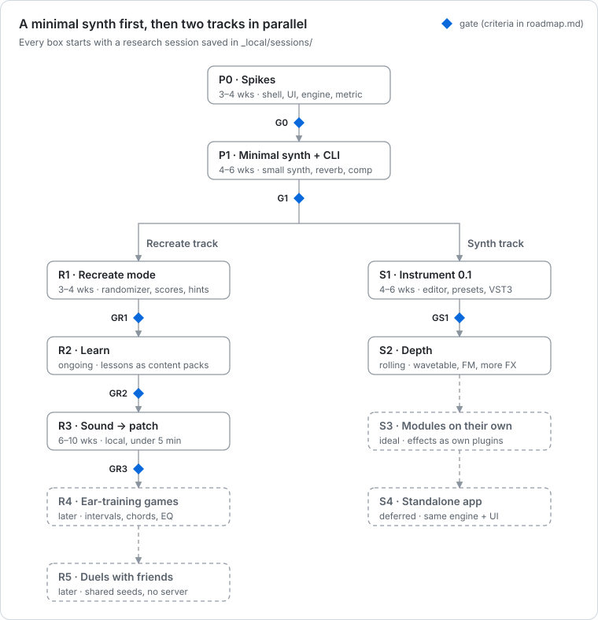

# Roadmap

**A minimal, Syntorial-sized synth first; then two tracks in parallel — Recreate (the game, learning, sound → patch) and Synth (depth and polish).** Every milestone starts with a deep-research session ([research-process.md](research-process.md)) before any code. Durations are rough guesses for one developer working with coding agents; the gates matter more than the dates. On 2026-10-19 Phase 0 replaced the *(set in P0)* placeholders with measured numbers (the G0 result below; derivations in [spikes/summary.md](spikes/summary.md)).

Changes from earlier plans:

- **2026-10-22:** R4 and R5 research (`_local/sessions/2026-10-22-r4-r5-ear-games-and-duels/summary.md`), planned together in [phase-4.md](phase-4.md) in heavy slot L while R3b keeps slot S; all provisional until you steer. **R4:** sound-design games come first, because musical training sharpens pitch but not brightness, so interval drills won't train a cutoff or decay ear: Spot the change, Dial it in, Ear check, Frequency finder, then Interval stacks, Chord quality and Rhythm pattern (listening only); progressions, opt-in note naming and tap-back after. Drills train at about 80 % (3-down/1-up), workouts end, progress is a threshold in semitones, ms or dB, and there are no streaks, leaderboards or perfect-pitch promises. **No engine change:** every stimulus is an offline render through the Target ▶ slot; new are a small L1 crate `enth-music`, Challenge v3 and a drill player in `enth-learn`, plus an offline biquad in `enth-dsp` for the EQ games ([ear.md](ear.md)). **R5:** async duels are **two codes** on code v1's reserved version-15 escape: a spoiler-free scorecard sent on finishing, then an answer code carrying the patch as a diff from the start; each side re-scores both answers on its own build, and times are reported, not checked ([duels.md](duels.md)). R5a (duels on Recreate) ships before R4. Live duels wait for GR1 and the standalone app.
- **2026-10-21:** R2 and R3 research (`_local/sessions/2026-10-21-r2-learn/summary.md`, `_local/sessions/2026-10-21-r3-sound-to-patch/summary.md`), planned together in [phase-3.md](phase-3.md) with one heavy build slot each; all provisional until you steer. **R2:** a lesson is Hear → Name → Try → Do → Check, then Review, and its "recreate this" steps are real Recreate rounds; a new core crate, `enth-learn` (L5), and Challenge v2 (judged at freeze F1l); four kinds of check, because sound alone cannot check the compressor, reverb, resonance or macros; **packs are bundled and R2 has no network code**, so downloading inside the plugin waits for GR1 and your OK; 42 lessons in four packs, with a 12-lesson tour as GR2's friend track ([learn.md](learn.md)). **R3:** today's search copies the damage in a degraded upload (noise 10 %, reverb 25 %, clipping 64 % against the clean target), so **R3a ships first with no ML** (a robust intake, a degradation-aware objective, a portfolio with k-NN retrieval, K branches on a cancellable pool), then **R3b** adds a K = 8 winner-takes-all model on **our own scalar kernels instead of `tract`** (bit-exact on every platform, about 0.1 MB against 15.5 MB); real audio without labels is a hypothesis; GR3's three clauses become testable ([r3.md](r3.md)).
- **2026-10-20:** R1 + S1 research (`_local/sessions/2026-10-20-r1-s1-recreate-and-instrument/summary.md`). R1 and S1 run in parallel on what exists, planned together in [phase-2.md](phase-2.md): five waves behind three freezes (F0r, F1r, F2r), about 22–42 agent-hours planned and 26–30 expected. Targets are the same on every machine because every random draw is keyed by its parameter address, never taken in sequence, and a challenge code carries the generator and engine versions and a target-hash prefix ([design.md §9](design.md#9-randomizer-and-difficulty)). Before sound % decides a pass it gets module mapping, metric v1.1's pooling, descriptor components, per-challenge calibration and a `libm` loudness ([ADR-0007](adr/0007-metric-v1.md)). The A/B plays a pre-rendered target against the live engine, with no engine work. Score disputes are the top risk, so an agreement vote and a local round log go into the first playable round. In S1, poly-mod is already done (only the Bitwig check is left), a fresh instance will play a gain-staged starter patch as "Init", and a preset load becomes one undo step. The friend build is CLAP and VST3 bundles first, from a tag-only `release.yml`, unsigned for R1; a standalone app waits for your OK; AU is deferred past S1. Docs-only pushes no longer run CI.
- **2026-10-19 (e):** P1b research (`_local/sessions/2026-10-19-p1b-plugin-editor/summary.md`). P1b is buildable on what exists, with an engine-seams lane (E+) in the spine and a privately vendored fork of nice-plug and baseview (CLAP slot names, an `editor_closed` fix, baseview's xkb leak fix, keyboard focus only while typing). The plugin renders exactly like the CLI (20 of 20 runs bit-identical), so "CLI = plugin renders" becomes a G1 check. The real-time row of G1 now gates on p99 and p99.9 under real-time priority and on swap blocks, and a plan swap moves effect state instead of copying it. The editor makes layout data, so each Claude Design variant becomes one file. The P1b lane plan is [phase-1b.md](phase-1b.md).
- **2026-10-19 (d):** P1a research (`_local/sessions/2026-10-19-p1a-headless-core/summary.md`). P1a is buildable as planned, with five design corrections: seeds never come from the patch hash; the processing quantum is a 32-frame segment behind a FIFO, not "block 64"; the reverb needs no RNG; the probe's 15 of 15 was partly a descriptor bug (13 of 15 when re-judged); and P1a gains a minimal `enth-solver` (hints), `enth-golden` and the text-goal agent-eval harness. G1's CPU budget is re-set, because (c)'s 340 M instructions per 2 s render was too tight for the real module set; macOS goldens run on demand or weekly; "a bass, pad, pluck and lead you like" moves to P1b. The P1a lane plan is [phase-1a.md](phase-1a.md).
- **2026-10-19 (c):** Phase 0 closed ([spikes/summary.md](spikes/summary.md)). G0 passes on the automated tier; the owner's real-display and listening checks are pending ([spikes/owner-checklist.md](spikes/owner-checklist.md)). ADR-0001 and ADR-0002 are accepted. The editor's PSS growth per open fails its gate until baseview's keymap leak is fixed upstream. G1 gets a proposed 16-voice CPU budget and an agent-eval protocol from the agent-loop probe.
- **2026-10-19 (b):** Phase 0 research (`_local/sessions/2026-10-19-phase-0-spikes/summary.md`). Phase 0 runs as parallel lanes and takes about 2 weeks. The UI spike is egui with glow only (vizia and iced are out); renders are bit-exact across platforms; Gate G0 has numeric metric and search thresholds; P1 splits into P1a (headless core) and P1b (plugin and editor); GR1 needs a survey of friends' OS and DAW and a friend build; second hosts are Carla (VST3 only) and a Bitwig trial for poly-mod.
- **2026-10-19 (a):** effects are ported from permissive sources into our own deterministic modules (a reverb from Signalsmith Basics, an in-house compressor), with a global FX bypass; no third-party plugin hosting ([ADR-0006](adr/0006-effects-strategy.md)).
- **2026-10-18 (b):** a minimal synth comes first, then the Recreate and Synth tracks run in parallel; a research session is mandatory before each milestone; duels are serverless; sound → patch may take up to 5 minutes; ear-training games and modules-as-own-plugins are listed for later.
- **2026-10-18 (a):** native UI instead of WebView, so Phase 0 includes a UI-toolkit spike; the agent CLI moved earlier; the standalone app was deferred.

## P0 — Spikes and skeleton (done 2026-10-19, except owner checks)

Research session: `_local/sessions/2026-10-19-phase-0-spikes/`. Lanes and tasks: [phase-0.md](phase-0.md). Planned at about 2 weeks; the lanes ran in parallel and were all merged on 2026-10-19. Results: [spikes/summary.md](spikes/summary.md); what waits for the owner: [spikes/owner-checklist.md](spikes/owner-checklist.md).

- Workspace, CI (fmt, clippy, tests, `cargo deny`, wasm32 build of core crates, layer check), AGENTS.md at the repo root.
- **Shell spike:** a one-oscillator synth on `nice-plug`, loaded in native REAPER (CLAP and VST3) and in Carla (VST3 only; Ardour is VST3-only too); `clap-validator` passes; VST3 export builds. A Bitwig trial is only for the CLAP poly-mod check.
- **UI spike:** the reference panel in **egui** on glow (with repaint gating), measured with the [benchmark protocol](benchmarks.md) in two tiers: automated under Xvfb, and owner-attended on the real GPU. No second toolkit.
- **Engine spike:** offline render speed (× realtime per core) and bit-exact renders across Linux, Windows and wasm32, with golden hashes in CI.
- **Metric spike:** a 10-parameter template; three candidate distances; two sessions of 30 pairs you rate by ear, whenever you have time; CMA-ES recovers random targets.

**Gate G0:**

- The plugin validates and runs in two hosts (REAPER and Carla) with no GUI-caused xruns.
- egui meets the [UI thresholds](benchmarks.md#ui-thresholds), including the owner's real-display checks.
- Renders are ≥ 100× realtime per core, and the golden hashes are identical on the platforms that have run (Linux, wasm32, Windows; aarch64 if runners exist).
- **Metric:** the best distance reaches Spearman ρ ≥ 0.7 against your mean rating of 30 pairs, with the lower 95% confidence interval ≥ 0.4.
- **Search:** with 8 workers and at most 60 s of wall time per target, at least 14 of 20 targets are judged *same* in an ABX listen.
- ADR-0001 and ADR-0002 become *Accepted*.

Metric v1 is provisional: it is recalibrated by your listening sessions and again in R1. Nothing in P1a waits for those sessions. *(Thresholds: 2026-10-19, from the Phase 0 research; the toy-synth numbers so far suggest they are reachable.)*

**G0 result (2026-10-19).** Status is *passed*, *pending owner* (real display, listening, Bitwig) or *failed*. Automated GUI numbers ran under Xvfb with Mesa software rendering; the per-threshold UI table is in [benchmarks.md](benchmarks.md#ui-thresholds).

| Gate | Measured | Status | Source |
| --- | --- | --- | --- |
| The plugin validates | clap-validator 0.4.1: 36 passed, 0 failed, 8 skipped, for spike-shell and spike-ui-plugin, debug and release, locally and in CI. Steinberg's VST3 validator: 537 of 537 | Passed | [shell.md](spikes/shell.md), [ui.md](spikes/ui.md) |
| Runs in REAPER | REAPER 7.82, CLAP and VST3: 45 `reaper-test` checks (params, automation, save and reload, offline render, 5 editor opens), 7 of 7 runs | Passed | [shell.md](spikes/shell.md) |
| Runs in Carla | Carla 2.5.8 (VST3 only): loads, 72 params, values and a byte-identical state chunk after save and reload. Playing, automating and the editor not tried | Passed for load and state; play and automate pending owner | [shell.md](spikes/shell.md) |
| No GUI-caused xruns | Not measured: Dummy Audio only | Pending owner (real audio, [owner checklist](spikes/owner-checklist.md) C3) | [ui.md](spikes/ui.md) |
| egui meets the UI thresholds | Idle editor: 0 frames in 22 s, GUI thread 0.05–0.19 % of a core. Animating: 1.16–1.41 ms CPU per frame before the GPU (3.5–4.2 % at 30 fps), 28.6–29.6 fps for a 60 Hz request. Open: 53 ms median (test host), 44–67 ms (REAPER). Threads constant over 200 cycles. PSS growth per open/close: 76.9 KB above baseline (16.1 KB with a one-line baseview fix). HiDPI clipped and Space lost after a click in REAPER | Automated tier passed except the PSS growth and the host checklist (both baseview, **failed**); real-display rows pending owner | [benchmarks.md](benchmarks.md#ui-thresholds), [ui.md](spikes/ui.md), [test-host.md](spikes/test-host.md) |
| Renders ≥ 100× realtime per core | 1-voice template 1,993× best, 1,783× median; 8-voice P1-like patch with reverb 152× / 149× scalar, 231× / 217× with f32x8 lanes; 16 voices 129× / 122× scalar (load 6–10) | Passed | [engine.md](spikes/engine.md) |
| Golden hashes identical across platforms | 1,010 hashes (10 renders, 1,000 seed → patch) identical on Linux x86-64 (local and CI), Windows x86-64 (CI `engine-golden`, first green run 2026-10-19), and `wasm32-wasip1` under wasmtime 48.0.6 with and without simd128 (local and CI); also across debug, release, `target-cpu=native`, FMA, LTO, lanes and FTZ/DAZ | Passed; aarch64 pending (manual CI job: no free arm runners for a private repo) | [engine.md](spikes/engine.md) |
| Metric: ρ ≥ 0.7, lower 95 % CI ≥ 0.4 | No ratings yet; the `listen` tool is built and dry-run tested | Pending owner (2 × 15 min) | [metric.md](spikes/metric.md) |
| Search: ≥ 14 of 20 judged *same* by ABX, ≤ 60 s on 8 workers | Proxy only: distance A with a heuristic start reaches the strict proxy threshold on 17 of 20 (19 loose), median 3.5 s and worst 10.9 s per solve; 17 / 14 / 15 on three search seeds. No ABX tool yet | Pending owner (and an ABX tool) | [metric.md](spikes/metric.md) |
| ADR-0001 and ADR-0002 accepted | Accepted 2026-10-19; their real-display checks are on the owner checklist | Passed | [ADR-0001](adr/0001-plugin-shell.md), [ADR-0002](adr/0002-ui-toolkit.md) |

## P1 — Minimal synth + CLI v0 (4–6 weeks)

A Syntorial-sized instrument, complete enough to make simple basses, pads, plucks and leads — and to be a fair target for the Recreate game.

2026-10-19: P1 splits in two, so the riskiest part (editor and host integration) no longer sits at the end of one long build, and the fastest feedback loops (offline, through the CLI) come first.

- **P1a — headless core:** everything below except the editor bullet: schema, patch, engine, render, analysis descriptors, modules, effects and CLI v0. 2026-10-19: P1a also includes a minimal `enth-solver` (the multi-parameter hints behind `check` and `step`, which need render and analysis and so cannot live in the CLI), the `enth-golden` harness, and the text-goal agent-eval harness (`content/agent-evals` with 10 goals, `cargo xtask agent-eval`), because G1 needs them. Lanes, freezes and owner gates are in [phase-1a.md](phase-1a.md).
- **P1b — plugin and editor:** the shell, the 72 host params, state save/load and a functional editor (marked *(P1b)* below). 2026-10-19: P1b gains an engine-seams lane and a vendored fork; lanes, freezes and owner gates are in [phase-1b.md](phase-1b.md).

The effort figures are still unvalidated guesses; Phase 0 records actual against estimated days per lane. The P1a plan counts agent-hours instead (about 52–93 in total, with a critical path of about 18–35, plus about 1.5–2 h of your time; see [phase-1a.md](phase-1a.md)). P1a took about 18 agent-hours. The P1b plan is sized from that: about 27–51 in total, with a critical path of about 13.5–24, plus about 2.5–3.5 h of your time (see [phase-1b.md](phase-1b.md)).

- Parameter schema with units, Patch v1 with ops and migrations, `Module` trait, plan compiler and swap, voice manager (poly, mono, legato, glide).
- Modules: 2–3 oscillators (classic waveforms plus a few wavetables), noise, a multimode filter (LP/HP/BP), 2 envelopes, 1–2 LFOs, a small modulation matrix, macros.
- Effects: a reverb ported from Signalsmith Basics (MIT; fundsp is the fallback) and an in-house feed-forward compressor (Julius O. Smith's Faust `compression_gain_mono` structure, STK-4.3, plus a Giannoulis 2012 soft knee and make-up gain, which JOS's function lacks), both zero-latency, deterministic modules in `enth-dsp`; a persistent global FX bypass; no third-party plugin hosting ([research.md §8](research.md#8-reusing-effects-and-hosting-plugins), [ADR-0006](adr/0006-effects-strategy.md); full reports in `_local/sessions/2026-10-18-effects-reuse-and-plugin-hosting/`).
- *(P1b)* A functional native editor (clear, not polished), 72 host params (8 macros + 64 slots), state save/load. Slot names refresh through a CLAP rescan (this needs a small nice-plug patch, carried in a privately vendored fork, decided 2026-10-19); VST3 in REAPER shows them too, because REAPER reads VST3 titles live (lane PL, 2026-10-20; [design.md §4](design.md#4-host-parameters-macros--automation-slots)).
- **CLI v0:** `schema`, `modules`, `params`, `new`, `apply`, `get`, `diff`, `render`, `describe`, `check`, `step`, `guide`, `bench`.

**Gate G1** (the headless items are checked at the end of P1a, the rest at the end of P1b): a 16-voice patch stays within the CPU budget; patches round-trip through JSON; golden tests pass on Linux, Windows and wasm32 on every push, and on macOS (on demand or weekly, and once before G1; GitHub bills macOS minutes at about 10× Linux on a private repo), reverb and compressor included; the reverb was chosen by a blind, level-matched A/B; an agent passes the text-goal evaluation below; and *(P1b, it needs the editor)* you can make a bass, pad, pluck and lead you like.

- **16-voice CPU budget** *(re-set 2026-10-19 by the P1a research, report 02; the Phase 0 proposal of 340 M instructions per 2 s render, about 3,540 per stereo frame, was derived from the spike's 146-instruction voice plus a 1.5× allowance and is [too tight for the real module set](spikes/summary.md#the-16-voice-cpu-budget-for-g1): the prototype needs about 610 M)*: a 16-voice P1 patch with every P1 module in use, reverb and compressor on, renders at **at least 10× realtime on one core** of this laptop, offline, and costs **at most 12,000 instructions per stereo frame** on the scalar path (a gungraun hard limit, re-based to the first product measurement plus 10 %); and its p99 and p99.9 `process()` time stay under 25 % of the 64-sample block deadline (333 µs) in the test host under real-time priority (rtkit `SCHED_RR`), also with a structural edit every 250 ms (P1b; [benchmarks.md](benchmarks.md#real-time-measurement-p1b)). The prototype measured 6,353 instructions per frame and 22.7× realtime (4.4 % of a core): a full voice is 229 instructions per sample, the reverb 2,574 per frame, the compressor about 160. Sub-budgets for diagnosis: voice ≤ 400 per sample, reverb ≤ 3,000 per frame, compressor ≤ 250 per frame.
- **Agent evaluation** (the Phase 0 probe showed the old wording, "half of 10 goals within 20 renders", passes trivially when the expectation list is given: 15 of 15 in 1–7 renders, [agent-probe.md](spikes/agent-probe.md#trial-2026-10-19)). Protocol, from the probe and risk #8 of the plan-risks report:
  - 10 starter text goals with their expectation lists given (the harness and the goals are built in P1a); an agent passes a goal when `enth check` passes within 20 renders;
  - 3 runs per goal; report the median renders, tokens and cost; name the model and the date;
  - **the gate:** at least half of the goals pass, and in a blind listen you judge at least 7 of the 10 final sounds to match their text;
  - a second, harder track where the agent writes its own expectations from the brief; reported, not gated, at G1;
  - `cargo xtask agent-eval` runs nightly or on demand, never as a merge gate (it needs API access, costs money and is not deterministic).
- **P1b's G1 rows** (2026-10-19, from the P1b research; the checks are in [phase-1b.md](phase-1b.md#the-plugin-side-g1-checks), and their status is [p1b-g1.md](p1b-g1.md), filled in by lane INT on 2026-10-20: everything automated passes, lane RT's real-time rows included, and the owner's three are pending; the owner's steps are [p1b-owner.md](p1b-owner.md)):
  - **CLI = plugin renders:** the engine's golden cases, rendered through the plugin in the test host, give the engine's own hashes (`cargo xtask host-render --package enth-plugin`);
  - the real-time row in the 16-voice bullet above, with swap blocks;
  - clap-validator with 0 failures on the debug and release bundles, and a byte-identical state round trip;
  - the editor leak at most 26 KB per open/close cycle with the vendored baseview fix, and 0 editor frames while idle;
  - the owner's: the editor on the real display, and "a bass, pad, pluck and lead you like" made through the editor;
  - Bitwig poly-mod is optional in P1b and stays owned by S1.

### P1a lane plan

2026-10-19, from the P1a research. The full plan, with per-lane ownership and acceptance, is [phase-1a.md](phase-1a.md).

- **A serial spine with three freezes.** S0 (workspace prep: every P1a dependency pinned, empty crates and files, xtask and CI stubs) gives **F0**. S1a (parameter and patch types with the whole P1a catalogue) gives **F1**, reviewed before anyone fans out. S2a (a walking skeleton: the `Module` roles, the segment grid, seeds, a stub per module kind, a reference saw, goldens on Linux, Windows and wasm) gives **F2**. After F2, spine types change only additively.
- **Six waves:** S0; then S1a, analysis and the reverb and compressor cores; then S1b and S2a; then voices, plan swap, oscillators, filter/envelope/LFO, the effect wrappers and CLI phase 1; then hints, CLI phase 2 and the listening tools; then the evals and the G1 table.
- At most 4 light lanes build at once. About 52–93 agent-hours in total, a critical path of about 18–35. Your time: about 1.5–2 h (a reverb A/B of 20–30 min, the G1 blind listen of 15–20 min, an optional skim of the parameter list).

### P1b lane plan

2026-10-19, from the P1b research. The full plan, with per-lane ownership and acceptance, is [phase-1b.md](phase-1b.md).

- **A serial spine with three freezes, and an engine lane in it.** S0b (workspace prep) gives **F0b**. S1s (the `enth-session` API) together with E+ (engine seams: slot and epoch-tagged events, a depth event, per-voice macro offsets, a read-only telemetry tap, `reset`/`position`, audition notes, the monitor-bypass fade, macro and mod-wheel events in `Performance`, and effect state moved at a plan swap) gives **F1b**, reviewed together by a judge agent. SK (a walking skeleton through the real plugin) gives **F2b**. After F2b, session, engine and plugin types change only additively.
- **Seven waves, two heavy slots each, every heavy lane paired with a light one:** S0b with E+; UI-C and TH, with S1s; SK and FK (the vendored fork), with S2s; ED1 and PL, with RH and owner build 1 (real display); ED2 and RT; INT, with owner build 2; later, LV (one per layout variant) once you pick.
- About 27–51 agent-hours in total, a critical path of about 13.5–24. Your time: owner build 1 (about 40 min), the layout pick (20–30 min), owner build 2 (60–90 min), real audio with 8 instances (30 min), and an optional Bitwig poly-mod check (45 min).

## R1 + S1 lane plan

2026-10-20, from the R1 + S1 research. The full plan, with per-lane ownership and acceptance, owner gates and the test strategy for the game logic, is [phase-2.md](phase-2.md).

- **A serial spine with three freezes.** S0r (workspace prep: `enth-challenge` created, every file pre-declared, three header hooks) gives **F0r**. CT (challenge, `RandomSpec`, code and score types) and SG (the session's game API) give **F1r**, reviewed together by a judge agent, because these types are persisted, go to friends and later carry duels. SKR (a round end to end in the plugin, with 5 golden challenges on Linux, Windows and wasm) gives **F2r**. After F2r, challenge, session and plugin types change only additively.
- **Five waves, two heavy slots each:** S0r with the friend build (FB), the one-hour REAPER soak (SOAK), the agent evals (EV2) and the docs; then add/remove modules (AM) with CT, SG, the randomizer and the preset core; then SKR and the preset browser with the scorers, coach, match, golden challenges and factory presets; then the Recreate UI with the CLI and the GR1 kit; then INT, owner build 3, a friend smoke round and GR1. Layout variants (LV) come when you pick one.
- About 22–42 agent-hours planned, 26–30 expected (calibrated on P1b's 20 measured hours against its 27–51 estimate); the critical path is about 8–11 h of wall time. Your time: about 3 h new (the friend survey first, owner build 3 with the preset pick, GR1's 20 rounds, the layout pick), plus the P1 backlog. Each friend: about 1.5–2 h.
- **Status (2026-10-20, lane INT):** every lane is merged, plus two unplanned ones (F1R, the judge's fixes; LK, the leak gate). Every automated GR1 and GS1 check passes; the tables are [r1s1-gates.md](r1s1-gates.md), and what is left (your rounds and your friends', the preset pick, the real display, the friend build) is [owner sheet 3](r1s1-owner.md).

## R2 + R3 lane plan

2026-10-21, from the R2 and R3 research. The full plan, with per-lane ownership and acceptance, the hotspot table, your part with its defaults, the cut lists and the open checks, is [phase-3.md](phase-3.md); the designs are [learn.md](learn.md) and [r3.md](r3.md).

- **Two spines, seven freezes, one heavy slot each.** R2: S0l (creates `enth-learn`) gives **F0l**; LM (the lesson model), CV2 (Challenge v2) and SL (the session's Learn API) give **F1l**, reviewed together by a judge agent; SKL (one bundled lesson end to end in the plugin) gives **F2l**. R3: S0s with the held-out sets (DS) gives **F0s**; the intake types and the create API give **F1s**, judged; SK3 (create end to end in the CLI and the plugin) gives **F2s**; the model contract on our kernel op set gives **F3s**, judged before any long training run.
- **Waves:** both start once fu1-hint and fu1-fk have merged, with the coordinator's pins first, then S0l, then S0s (both touch the root manifests). R2 runs five waves to INT2, owner build 4 and GR2; R3a five waves to INTa, your 5-sound check and its release; R3b four more (our kernels, `ds1`, augmentation, training, model + search, the GR3 runs and listening).
- About 22–40 agent-hours of code plus 6–9 of content for R2 (roughly 9–13 h of wall time); about 14–18 for R3a and 11–16 for R3b, plus 1–3 days of training. Your time: about 3–4 h for R2 (a taste check of two lessons, owner build 4, GR2) and 2.5–3.5 h for R3 (picks, the R3a check, GR3's 25-minute listen), after owner sheet 3.

## R4 + R5 lane plan

2026-10-22, from the R4 and R5 research. The full plan, with per-lane ownership and acceptance, the hotspot table, your sittings with their defaults and the open checks, is [phase-4.md](phase-4.md); the designs are [ear.md](ear.md) and [duels.md](duels.md).

- **One heavy slot, four freezes.** Slot S stays R3b's, so every heavy lane here runs in slot L, one at a time. S0e (creates `enth-music`, the stubs, the features `ear` and `duel`, the reserved code kinds) gives **F0e**; the music, Challenge v3, result-code, drill and session APIs give **F1e**, judged together because every persisted form goes to friends; SKD (a result copied after a pass and verified in a second instance) gives **F2d**; SKE (Spot the change and Interval stacks end to end in the plugin and through `enth ear`) gives **F2e**.
- **Nine waves:** DOCS4; S0e; the API lanes with the fork's tap stamps (FK4), then the drill player and the biquad; SKD with the judge's fixes, `ear-check` and the ladder drafts; the duel card and INT5, where **R5a ships**; SKE with the chord, rhythm and EQ ladders; the Ear view; the tap spike and tap-back; INT4, owner build 6 and a friend round.
- About 28–47 agent-hours. R2 took about 25 h of wall time against 9–13 planned, which puts R5a about 12–18 h out and R4 25–40 h. Your time: about 4–5 h over two weeks (the summary, an optional taste check, one duel with a friend, owner build 6, GR4's two weeks).

## Track R — Recreate

### R1 — Recreate mode (3–4 weeks)

The game you most want: the synth makes a random patch, you recreate it, and you get a smart score.

2026-10-20: planned together with S1. Lanes, freezes, owner gates and the test strategy for the game logic are in [phase-2.md](phase-2.md); the generator, codes, A/B and feedback are in [design.md §9](design.md#9-randomizer-and-difficulty).

- A **Recreate** button that turns the plugin into game mode (no separate app or onboarding).
- **Randomizer settings page** ([design.md §9](design.md#9-randomizer-and-difficulty)): how much each category is randomized, a musical/safe slider, and one difficulty knob that widens what gets randomized (oscillators → filter → envelopes → modulation → effects). Everything stays available — difficulty changes the challenge, it doesn't lock features.
- Instant level-matched A/B, a 0–100 score with sound %, structure % and combined %, time to pass, and coach hints from measured sensitivity.
- CLI: `compare`, `suggest`, `match`, `explain`; the `content/agent-evals` set grows to about 30 goals plus reference sounds (the harness and the first 10 goals land in P1a).
- **Prerequisites for the friends' round (GR1):** ask your friends now which OS and DAW they use (Ableton, Logic and Cubase had no CLAP support as of July 2026), then provide a **friend build**. 2026-10-20 (R1 research): **plugin bundles first**, CLAP and VST3 for Linux, Windows (MSVC, static C runtime) and macOS (one universal bundle), from a `release.yml` that runs on a tag or by hand, never on push, with clap-validator on each leg. **Unsigned for R1:** the macOS bundles are ad-hoc signed and need one Terminal line each (`xattr -dr com.apple.quarantine`); Windows gets no signing. A **standalone app** (for Logic users and friends with no DAW) comes only after your OK, because it pulls system audio and MIDI libraries; AU is deferred past S1; signing (Developer ID and notarization on macOS, a Windows certificate) waits for a public S1. If that is too much, GR1 becomes owner-only and the friends join in S1.

**Gate GR1:** you and friends (on a build they can run) play 20 rounds each, mostly agree with the score, and want more; the agent's solve rate is recorded as a baseline.

### R2 — Learn (ongoing)

Lessons as **content packs** (markdown + patches + challenges), bundled first; downloading them from the project's GitHub releases with a button comes only after GR1 and your OK (2026-10-21). Nearest-solution knob feedback; auto-generated "deconstruct this preset" lessons; lessons go from basics to advanced sound design.

2026-10-21 (R2 research; provisional until you steer). Lanes, freezes and acceptance are in [phase-3.md](phase-3.md); the design of record is [learn.md](learn.md); the curriculum is [the lesson plan](../content/lessons/PLAN.md).

- **A lesson teaches one control or idea in 5–10 minutes:** Hear → Name → Try → Do → Check, then Review in later sessions. You hear a contrast before the explanation; scaffolds fade (hidden, dimmed, normal); hints thin out by tier; no spectrum during Do.
- **Lessons reuse the game:** a "recreate this" step is a real Recreate round, the coach's levels are the hint ladder, and "How close am I?" (CMA-ES from your patch, `enth-solver::closest`) follows a failed Submit, with a sibling challenge after it.
- **42 lessons in four packs** (36 core in the generator's order, 6 studies built from the preset candidates), covering all 54 P1 parameters; **a 12-lesson tour** (one lesson per module, about 1.5 h) is GR2's friend track and is written first.
- **Bundled, with no network code in R2:** about 60 lessons zip to about 0.2 MB, while a TLS stack would add 2.2 MB and a C toolchain. Packs are `.enthpack` files (`enth.pack/1`) embedded in the build, plus a `<Documents>/enth/Packs` folder and a "Get more lessons" button that opens the releases page in the browser. In-plugin download needs your OK on a C toolchain (`ring`) or a new crate (`graviola`).
- **Code home:** a new core crate, `enth-learn` (L5), with `enth-session::learn` (L6, which enforces locks in the edit path) and `enth-ui::editor::learn` (L7). Challenge v2 is the one persisted change.
- **The authoring loop first:** `cargo xtask lesson-check` plays every lesson's reference solution through a real session and checks reachability with the solver; a `lessons.yml` workflow, since lesson-only commits run no CI.

**Gate GR2:** the lessons cover every P1 module, and you and friends learn something new from them. 2026-10-21: the first half is mechanical (`lesson-coverage`: every module and Basic-tier parameter has a step and a non-patch check, an ear question included); the second is parallel-form pre- and post-tests made of challenge codes, a staggered mid-test, and "name up to three things you learned", all local and reported per person ([learn.md](learn.md#gr2); the pass criteria are yours to set).

### R3 — Sound → patch (6–10 weeks)

"Create from sound": heuristic start + CMA-ES, then learned proposals returning several candidates (2026-10-21: on our own scalar kernels, not ONNX + `tract`). Fully local. **Budget: under 5 minutes per sound on your laptop; aim for about 60 seconds.**

2026-10-21 (R3 research; provisional until you steer). Lanes, freezes and acceptance are in [phase-3.md](phase-3.md); the design of record is [r3.md](r3.md).

- **R3a ships first, with no ML.** Measured on one target, today's search copies the damage in an upload (scored against the clean target: MP3 92 %, noise 10 %, reverb 25 %, clipping 64 %; trimming the noisy tail alone gave 56 %). So R3a has a robust intake (trim, noise floor, bandwidth, clipping, the inferred note and hold) and a degradation-aware objective under a new metric id, a portfolio of starts (the heuristic, templates, k-NN retrieval over a pre-rendered bank), and K branches refined by successive halving on a cancellable pool of its own, in the CLI and the plugin (file drop or a folder browser).
- **R3b adds a narrow model:** a small CNN with K = 8 winner-takes-all hypotheses and a confidence head, whose categorical heads matter most (CMA-ES solves 0 of 4 level-5 codes). Its proposals are extra starts, never the only ones; it must beat k-NN retrieval and search alone. Inference runs on our own scalar kernels, bit-exact on every platform; the weights are a separate model file beside the plugin.

**Robust to real-world audio** (owner, 2026-10-19). Users upload degraded sounds, so training renders go through realistic augmentation:
- codecs at low bitrates (MP3 128 kbps and below, AAC, Opus), resampling, low bit depth;
- clipping, limiting and heavy compression;
- room reverb, background noise and hum;
- EQ tilts (phone or laptop speakers), stereo-to-mono;
- trimmed, layered or mixed-in sounds;
- varied note, velocity and length.

Unlabelled real recordings train the audio side. The R3 research session covers augmentation design and its licences: codec encoders such as LAME are LGPL, which is acceptable in the never-shipped `ml/` pipeline but never in the product.

2026-10-21 (R3 research):

- **Real audio without labels is a hypothesis, not a plan.** In 2026 papers it helped through render rewards and barely as a passive input. Its first use is search-distilled pseudo-labels (model + search on real one-shots, the good fits kept), capped at about 30 % and listened to batch by batch.
- **Training data comes from our engine**, through a new sampler (`ds1`) beside generator v1, which is unfit as it stands (level 1 has about 12 sounds, every phrase starts on C3). The augmentation chain above is buildable today, with LGPL and GPL tools only as subprocesses in `ml/`; held-out codecs, rooms and noises stay evaluation-only; shipped weights train only on our renders plus CC0, CC BY or Apache data.
- **The degradation policy** (yours to decide; the default): codec damage, hum, noise and device EQ count as damage to ignore; for room reverb and compression, the K candidates include a dry patch and one using the patch's own reverb or compressor.

**Gate GR3:** on held-out sounds from our own synth, model + search beats search alone at equal time; on real samples, **including a held-out set of degraded uploads (low-bitrate MP3, noisy, reverberant, clipped)**, a blind listening test prefers it; every result arrives in under 5 minutes. 2026-10-21, how each clause is run ([r3.md](r3.md#gr3-and-its-hygiene)):

- **Clause 1:** model + search against the *best tuned* search at equal wall-clock time, inference charged, on about 120 held-out targets (McNemar on pass rate, Wilcoxon on JND distance, at 60 s and to 300 s), plus one metric no arm optimises.
- **Clause 2:** forced choice "which is closer to the reference?", level-matched, top candidates only, with catch trials; 60 references, 20 of them degraded and **judged against the clean original** (judging against the upload would reward copying the noise); a cluster-bootstrap rule fixed in advance. You listen for about 25 minutes; friends get a 30-reference kit.
- **Clause 3:** a cap guarantees 5 minutes, so the gate is on time to the first candidate (at most 15 s) and on no xruns while a search runs in the DAW.
- **Hygiene:** the held-out sets are frozen and hashed before any training, and no prior is fitted on presets that are also test targets.

### R4 — Ear-training games (later)

SoundGym-style games built on the same Challenge object: intervals, opt-in note naming, chord progressions, rhythm and syncopation, EQ A/B.

2026-10-22 (R4 research; provisional until you steer). Lanes, freezes and acceptance are in [phase-4.md](phase-4.md); the design of record is [ear.md](ear.md).

- **Sound-design games first, music theory second.** Musical training sharpens pitch but not brightness (Allen & Oxenham 2014), so interval drills won't train a cutoff or decay ear; the sound-design games are also the cheapest, each a one-item draw plus a choice or a one-knob Recreate round.
- **R4a, in order:** Spot the change (which knob moved?), Dial it in (match one knob by ear), Ear check (a staircase that reports your threshold in real units), Frequency finder (svf bands now, EQ boost and cut on an offline biquad), Interval stacks, Chord quality, Rhythm pattern (listening only). **R4b:** progressions, **note naming (opt-in, never in the default workout**, with honest copy: most adults who train for about 20 hours learn a handful of notes, a few all twelve, most stop sooner) and tap-back; tap-along is deferred.
- **Honest training:** about 80 % success (3-down/1-up; Recreate keeps 2-down/1-up); workouts of 3 games × about 4 minutes that end; progress as thresholds in semitones, ms, cents or dB; no streaks, leaderboards or perfect-pitch promises. A due skill comes back through any game as a 5-item burst that moves its Review box.
- **No engine change.** Every stimulus is an offline render played through the existing Target ▶ slot. New: `enth-music` (L1, theory tables and a frozen ear generator), Challenge v3 (`Target::Ear`; choice, value and tap answers), a drill player in `enth-learn` whose ear skills feed Review, and an offline biquad in `enth-dsp`.
- **Rhythm timing is the one real unknown:** the editor sees input once per frame. Listening-only rhythm comes first; tap-back is scored on the intervals between taps after a measured spike; host-MIDI taps need a new audio-thread path and your OK.

**Gate GR4** (proposed; you set the criteria, [ear.md](ear.md#gr4)): the games are deterministic, fair and solvable, checked in CI by `ear-check` (identical hashes on six targets, options at least 2 JND apart, an ideal-observer bot at 95 % or more and bias bots at chance, staircases that recover simulated thresholds); and you and at least two friends hear finer differences on two trained skills than on two held-out ones after two weeks of short workouts, against a retest bar you set in a pilot. Results are described, not tested (N = 3–6).

### R5 — Duels with friends (later)

No server-side compute. Thanks to determinism, a challenge is just a **seed + settings**, so both players generate the identical target and score locally.

1. **Async duels over any chat:** share a challenge code; each player sends back a **scorecard** when they finish (spoiler-free: the challenge, engine, scores, time, assists and a salted commitment to the answer), then, once both have played, an **answer code** that carries the patch as a diff from the start. Each side re-scores both answers on its own build, so claimed numbers never decide; times and assists are reported, not checked. No networking code at all.
2. **Live duels:** peer-to-peer, LAN first; over the internet only with a minimal rendezvous if ever needed.

2026-10-22 (R5 research; provisional until you steer). Lanes are in [phase-4.md](phase-4.md); the design of record is [duels.md](duels.md).

- **R5a ships first:** duels on Recreate, before R4's games. The two codes take code v1's reserved version-15 escape; an answer is about 50, 135 or 255 symbols at levels 1, 3 and 5, so it fits every chat app but not one SMS. A duel compares each player's first passing submit.
- **Honest limits, stated in the UI:** a code proves what a patch scores, never who made it or how long it took (`enth match` passes 11–13 of 20 golden and GR1 codes in 6–12 s). Scores read "checked on your computer", times "reported"; never "proof" or "anti-cheat". A friend's answer stays sealed until you've played or given up; afterwards it loads as one undo step, so a duel becomes a lesson.
- **Privacy:** no names, machine ids, absolute times or patch `meta` in any code; names stay optional and local; the clipboard is read only on an explicit Paste.
- **A daily challenge per level** from a frozen formula of the UTC day, with no server ([challenge.md](challenge.md#the-daily-challenge-formula-r5-planned)). Ear duels come after R4's games, on a fixed ladder.
- **Live duels after GR1, in the standalone app first:** LAN discovery (mdns-sd) plus a typed `IP:port`, plain TCP or QUIC, no relay of ours; libp2p and iroh are out. The obstacle is the OS: macOS's local-network permission and Windows' firewall rule name the DAW, not the plugin. A research session comes first.

**Gate GR5** (proposed; you set the criteria, [duels.md](duels.md#gr5)): three async duels finish with both codes verified both ways, any score difference explained by a flagged engine difference; codes survive a paste through Discord, Telegram, WhatsApp, Signal, SMS and iMessage, smart punctuation included; a test shows no name, `meta` or absolute time in any code.

## Track S — Synth

### S1 — Instrument 0.1 (4–6 weeks)

Polished editor (generator / modulator / effect lanes, drag-to-modulate with depth rings, scopes), preset browser, undo/redo, CLAP poly-mod on macros, VST3, Windows and macOS builds in CI.

2026-10-20: planned together with R1 in [phase-2.md](phase-2.md). CLAP poly-mod on macros is already implemented and test-host-checked (P1b lane PL), so only your Bitwig check is left. The editor gains add and remove (and a fresh instance plays a gain-staged starter patch as "Init") and a preset browser whose loads are one undo step. Windows and macOS builds come from `release.yml`, on a tag or by hand, plus a per-push cross-target clippy guard on the Linux runner.

**Gate GS1:** ten presets you'd actually use; no crashes or audio-thread allocations under `clap-validator` and a one-hour REAPER soak; the real editor still meets the UI thresholds.

### S2 — Depth (rolling)

Wavetable import/editing, FM/PM/AM between generators, unison, more effects (a "lush" reverb ported from CloudSeedCore, chorus/flanger/phaser, anti-aliased saturation, EQ, a safety limiter), multi-segment envelopes, random modulators, MPE, oversampling, SIMD voices. Each feature lands with its lessons (R2) and agent evals.

### S3 — Modules on their own (ideal)

Any effect (and maybe generator) exportable as its own small plugin, Kilohearts Snapin-style, without bloating the main synth. Kept possible by the module boundaries in [architecture.md](architecture.md#modules-as-their-own-plugins-ideal).

### S4 — Standalone app (deferred); web (maybe never)

Standalone: window + the same egui editor + `cpal` audio + `midir` MIDI. 2026-10-20: it may come early, in R1's friend build, as `enth-standalone` on nice-plug's `standalone` feature (it compiles for Linux, Windows and macOS, and its licences pass `cargo deny`), once you OK its system libraries; until then the friend build is plugin bundles only. Web, only if wanted: engine in an AudioWorklet (wasm32) + egui compiled to wasm.

## Light and heavy builds (later, prepared now)

Learn content ships as data packs, not code; the Learn and Recreate views sit behind cargo features, so a lean build that leaves them out is a build flag, not a refactor.

## Don't build yet

| Until | Leave out | Why |
| --- | --- | --- |
| G0 | Any UI beyond the reference panel | egui is confirmed only at G0, after the real-display and in-host checks |
| G1 | Editor polish, AU/AAX, MPE, preset cloud, standalone app | The minimal synth must work first |
| GR1 | ML of any kind, networking, MCP server | The game and agent loop must work with plain search first. 2026-10-21: R3a and R2 have neither (packs are bundled); whether R3b's training waits for GR1 is an open check for you ([phase-3.md](phase-3.md#open-checks)) |
| GR3 | Topology search, text-to-patch models | Templates must work before structure search pays off |
| GS1 | Hosting third-party plugins inside the synth | Costs weeks and breaks determinism, the CLI and preset sharing; the DAW's FX chain already provides it. Even then only a CLAP-only post-FX slot after the scoring tap; anything more needs a new ADR ([ADR-0006](adr/0006-effects-strategy.md)) |
| Never | Server-side compute or cloud AI; a differentiable PyTorch copy of the engine; plugdata/Pure Data in the core | Local-first; one engine of truth; GPL and a second runtime |
